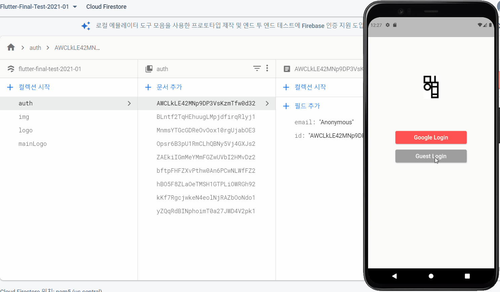
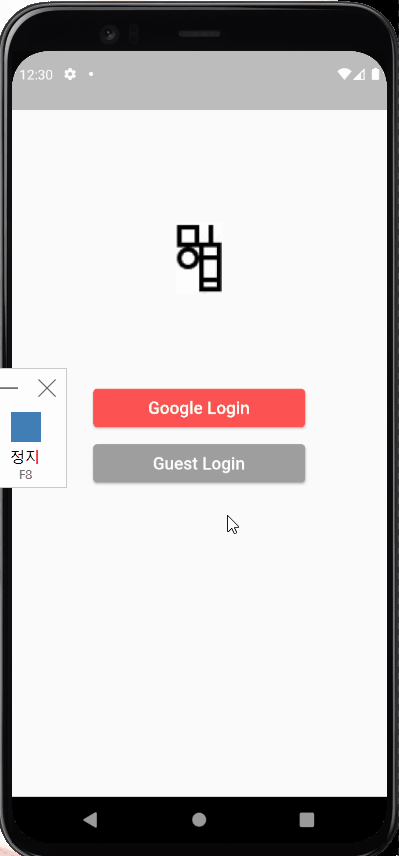
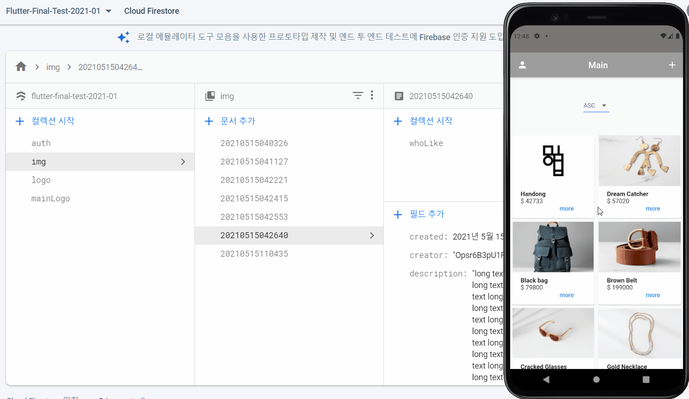
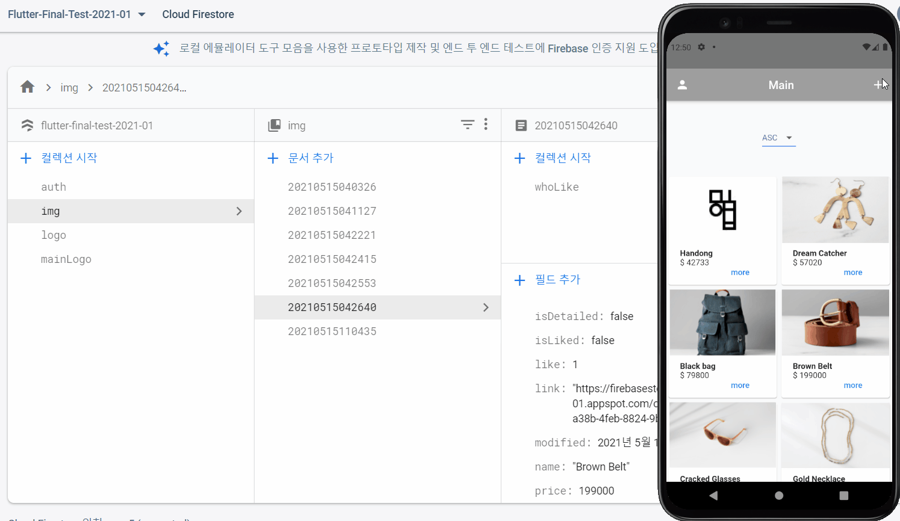
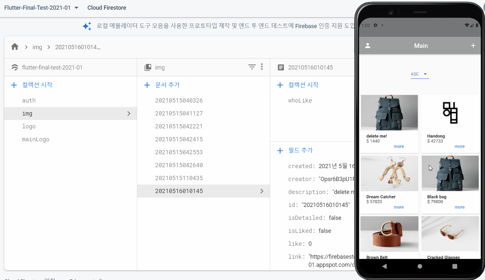
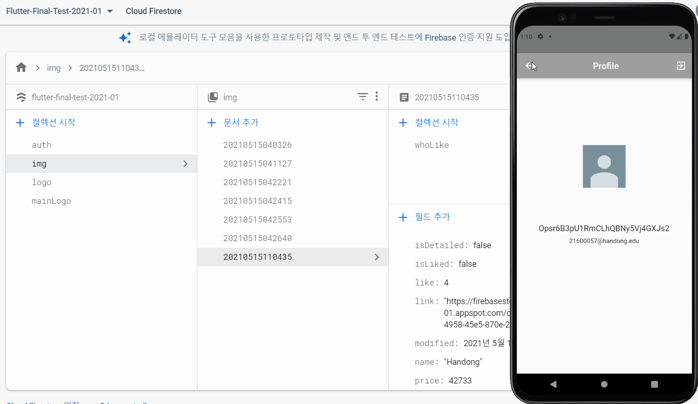
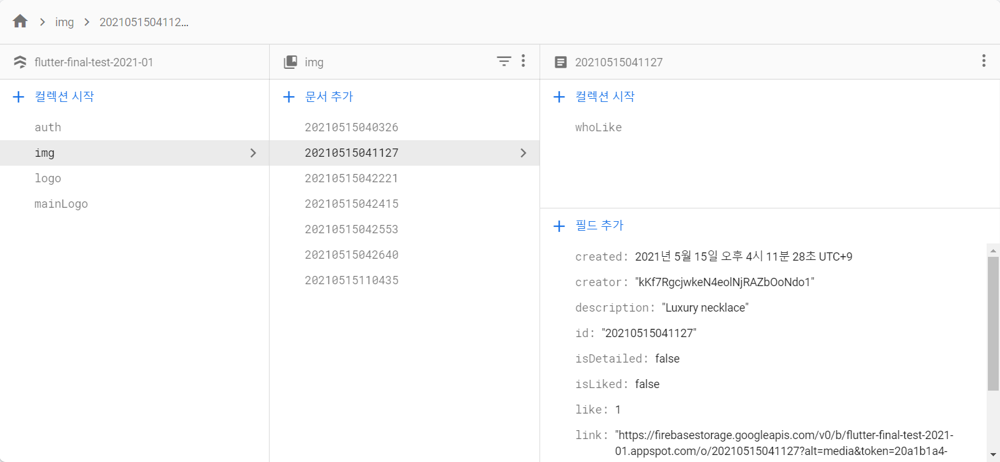
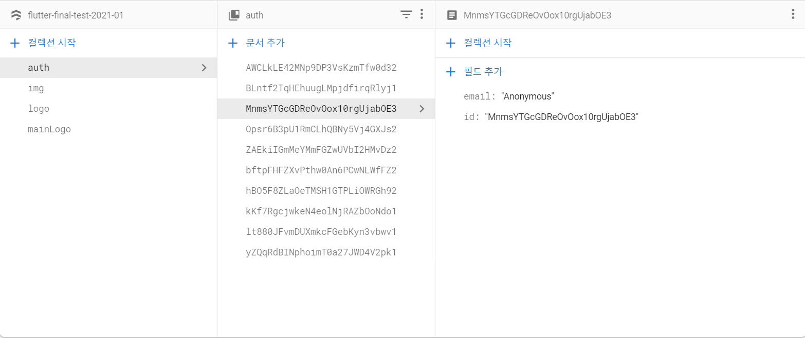

### 🔥 Flutter with firebase

예전 프로젝트에서 Route 간에 데이터를 주고받을 때 database를 쓰지 않았다.  
> 참고 : [Hotel 예약 앱 만들기](https://kdjun97.github.io/flutter/hotel-reservation-app/)  

하지만, database 수업도 들었고, firebase라는 것도 수업에서 익히게 되었기 때문에, 이 기술을 적용하여 훨씬 dynamic한 앱을 만들어보기로 하였다.  
참고로 **모바일 앱 개발**수업에서 주어진 시간동안 만들었던 앱이고, 대략 2주정도 시간을 줬던 것 같다.  

한가지 특이한 점은 이 앱을 개발할 때 `provider`와 `consumer`에 대한 개념을 적용했는데, 아주 유용한 기능이다.  
이 곳에서 연습을 통해 더 자세하게 배울 수 있다.  
> 참고 : [Firebase Codelab](https://firebase.google.com/codelabs/firebase-get-to-know-flutter#0)  

이번엔 이 전과 비해 코드가 더 간결해진 것 같다. 시작해보자.  

---

### 📹 간단한 영상 첨부와 동작 설명

`Guest Sign In and Sign Out`  

   

`Google Sign In and Sign Out`  

password 입력부분이나 나머지 셋팅 부분은 잘랐다.  
   

`Main & Detail Page`  

아이템 가격순으로 정렬이 가능하다.  
`StreamBuilder`를 통해 데이터의 변화를 감지하기 때문에 즉각적으로 변경된 사항을 확인할 수 있다.  
more 버튼을 클릭하면 Detail Page로 이동한다.  
Detail Page의 Like는 한 사용자가 아이템당 1번만 누를 수 있게 설정했다.  

   

`Item Add(Upload To Firebase Firestore)`  

ImagePicker로 Image를 선택해 Upload한다.  
Firebase Storage에 이미지를 올리고, Firebase Firestore Database에서 이미지에 관한 정보를 넣어준다.  

   

⚠️ 참고 : ImagePicker는 갤러리에서 사진을 선택하거나, camera로 찍은 사진을 선택하여 file형태로 반환해주는 image_picker plugin에 있는 함수이다.  
{: .notice--warning}  

`Item Delete`  

해당 item의 owner(creator)라면 delete가 가능하게 함.  

   

`Item Edit`  

해당 item의 owner(creator)라면 edit이 가능하게 함.  

   

---  

#### 💿 데이터 모델링

firebase는 NoSQL이다.  
firestore는 collection...document...collection...document...로 데이터가 저장된다.    
  

`auth(user 정보) 부분`  

**collection('auth').doc(user info)**  

guest login과 google login에 대해 다른 정보를 넣어주었다.  
~~google login정보는 일부러 보여주지 않음~~  

  

`img(item 정보) 부분`  

**collection('img').doc(item info).collection('whoLike').doc(좋아요를 누른 유저 정보)**  

img collection 안에 각 item에 대한 doc이 등록된다.  
doc의 id는 register날짜로 했고, field는 item에 대한 name, price, description 등을 가진다.  
또 collection('img').doc의 collection에 whoLike를 만들어 주고,  
whoLike collection은 누가 좋아요를 눌렀는지에 대한 값을 가진다.  
whoLike의 doc의 field는 uid와 좋아요를 눌렀는지에 대한 bool type의 field가 있다.  

  

나중에 이 정보를 가지고 쿼리를 돌리게 된다.  

🔥 이런 식의 db 구성은 좋지 않다는 것을 기억!  
{: .notice--danger}

---

#### 🧹 정리

flutter로 앱을 만들고, 관련된 정보들을 firebase에 연동시켜보았다.  
SignIn 관련 class에서 **ChangeNotifier**를 extends하여, 해당 class 안에서 값이 변할때마다 **notifyListeners()**로 알려준다.   
**ChangeNotifierProvider**에서 SignIn class를 create해주고, **StreamBuilder**를 통해, 값의 변화에 따라 UI를 계속 바꿔준다.  
또한, NamedRouter로 Navigator를 했던 예전과 달리, **ChangeNotifierProvider**에서 **notifyListeners()**로 값이 계속 변화하는 것을 감지하고,  
그 변화된 값을 통해 분기를 나눠 보이는 Page들을 달리 해주었다.  
이런식으로 코딩을 하니 훨씬 더 간결하게, 깔끔하게 코드를 짤 수 있었다.  
협업을 할 때, 내가 로그인을 담당한다면, 로그인이 완료되었는지에 대한 정보만 넘겨주면 되기 때문에 협업에도 아주 중요한 부분인 것 같다.  