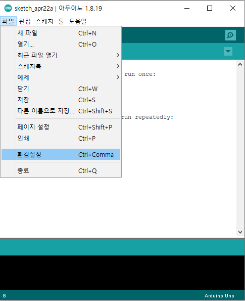
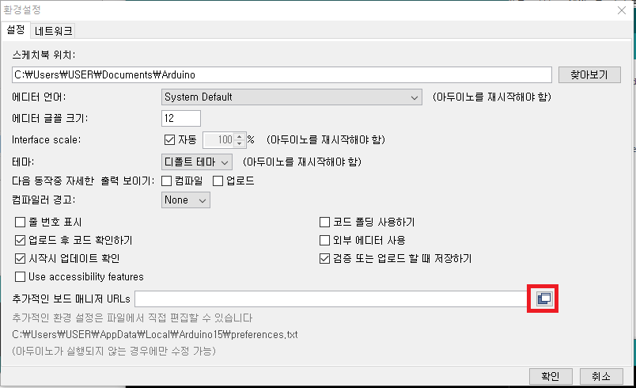
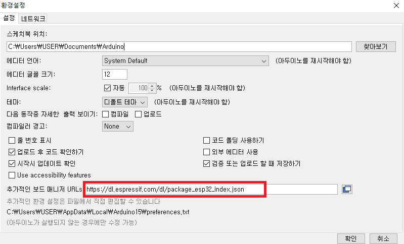
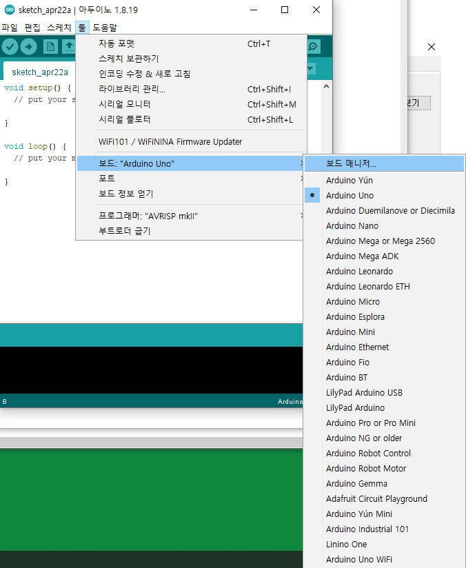
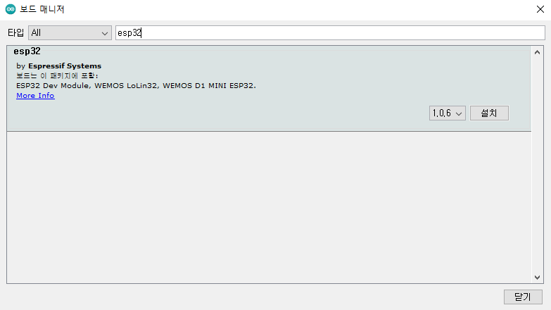
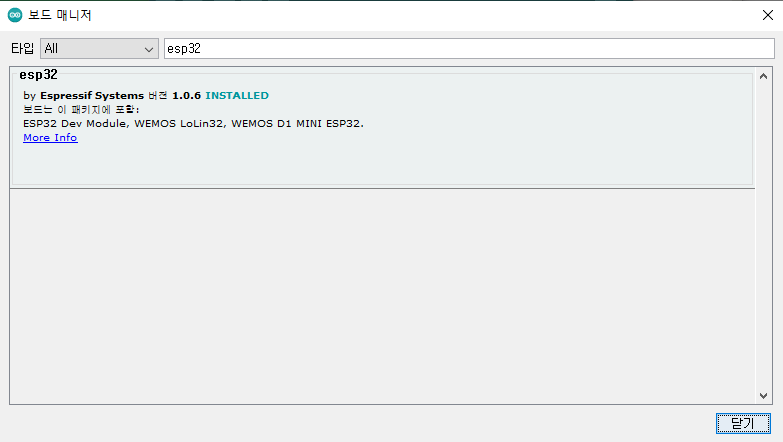
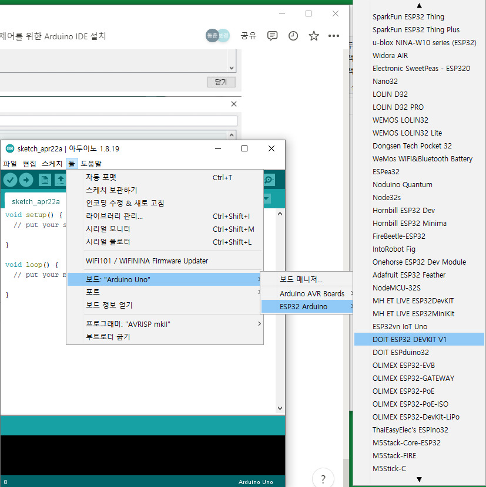
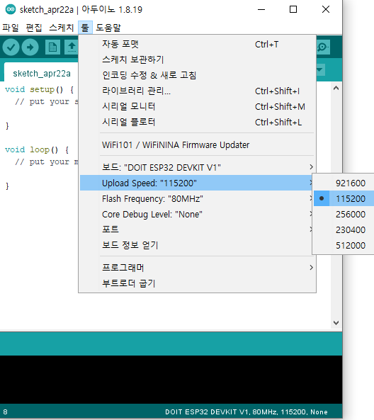
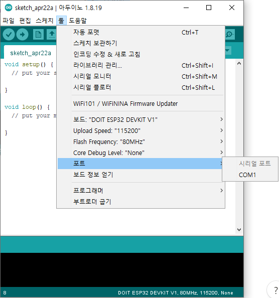
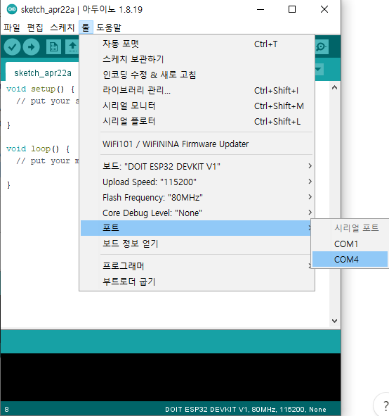

🔥 총 3편으로 구성된 예제이다.  
{: .notice--warning}

# 🎒 Arduino IDE Setting

`준비물`  

보드 : ESP32 Devkit V1  
Arduino IDE : 1.8.19 Version  

**1.** `파일 → 환경설정`  

  

**2.** `추가 보드 매니저 URL 추가 후 확인 (아래 링크 붙여넣기)`  

> https://dl.espressif.com/dl/package_esp32_index.json  

  
  

**3.** `보드 매니저 클릭`  

  

**4.** `esp32를 사용하기 위해 검색 후 설치`  

  

  

**5.** `DOIT ESP32 DEVKIT V1 설정`  

  

**6.** `Upload Speed 115200`  

(코드 측과 셋팅 값을 맞추기 위함)  
    
  

**7.** `Set Port`  

  

(위 그림은 ESP32 USB 연결하지 않은 상태의 포트)  

  

(위 그림은 ESP32 연결한 상태에서의 포트)  

⚠️ [2편에서 이어집니다](https://kdjun97.github.io/iot/arduino-ble-testing/)  
{: .notice--info}  