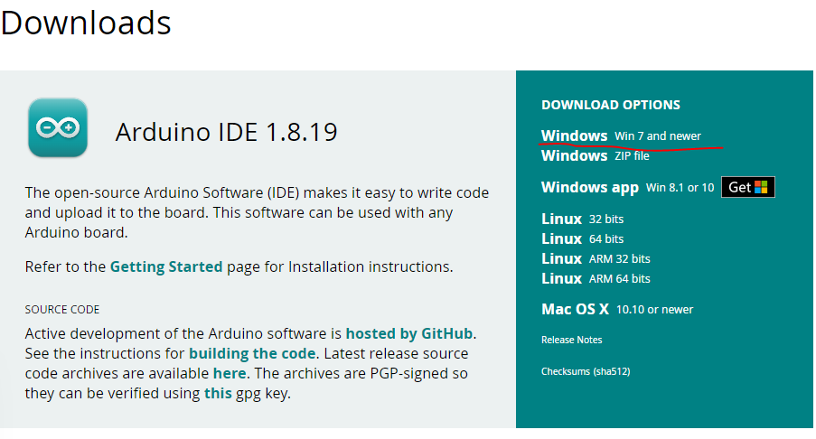
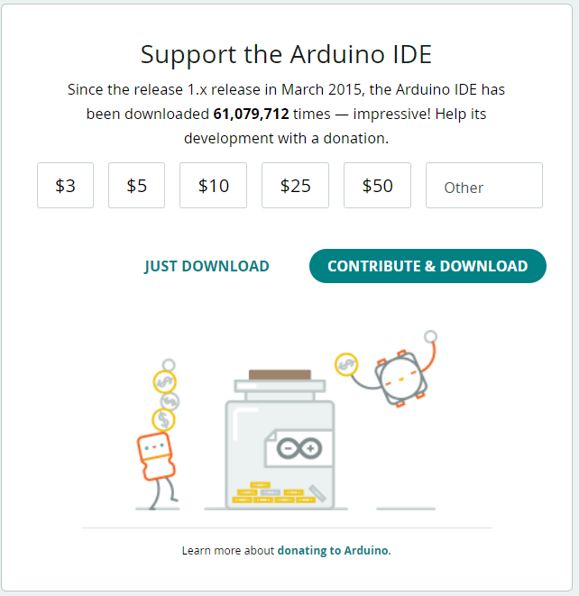
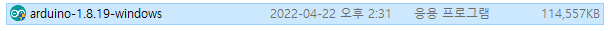
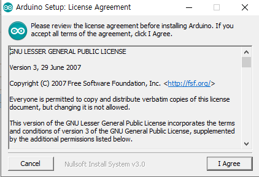
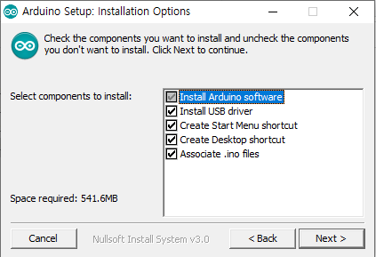
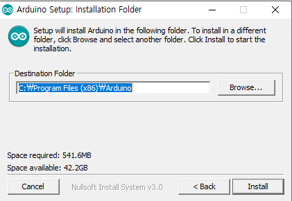
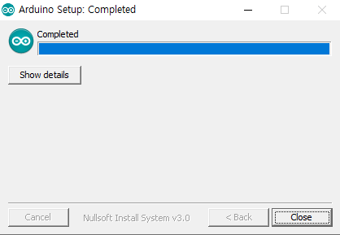
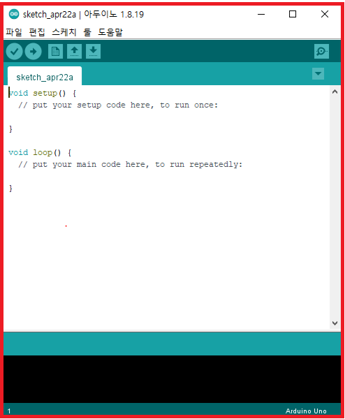

## 🛠️ Setup Arduino IDE

**1.** `Move Arduino Homepage`  

> [Software Link](https://www.arduino.cc/en/software)  
    
**2.** `Downloads`  
    
  
    
**3.** `JUST Click the DOWNLOAD button! (If u wanna donate, click CONTRIBUTE & DOWNLOAD 🙂)`  

  

**4.** `Complete`  
    
  
    
**5.** `Press I Agree button`  

  
    
**6.** `Next Button`  
    
  

**7.** `Install (Recommed default path)`  
    
  

**8.** `Close`  

7번 과정에서 USB Driver 설치 관련은 다 Install

  

**9.** `Run Arduino IDE`  

  
