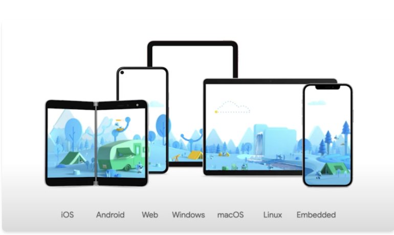
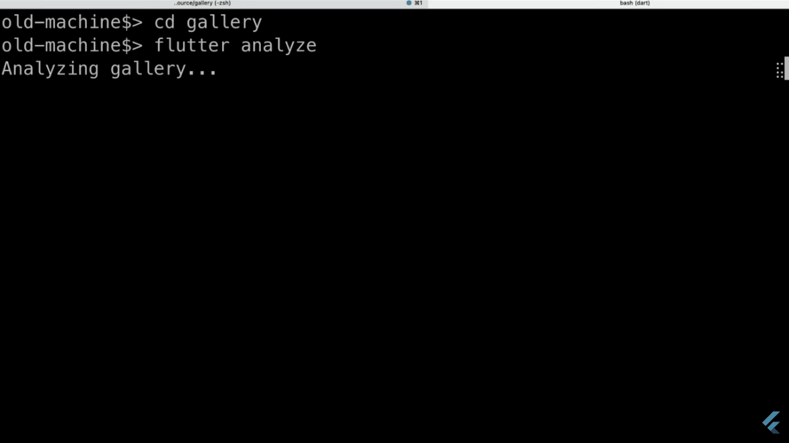
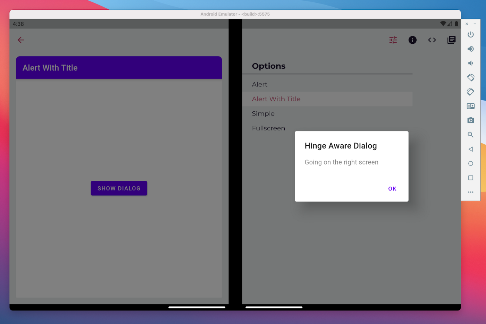
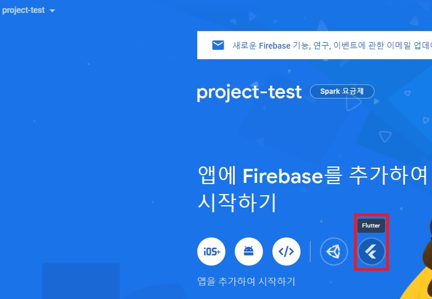
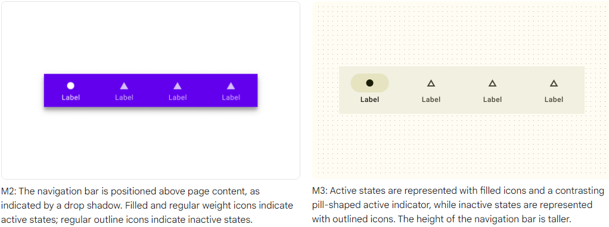
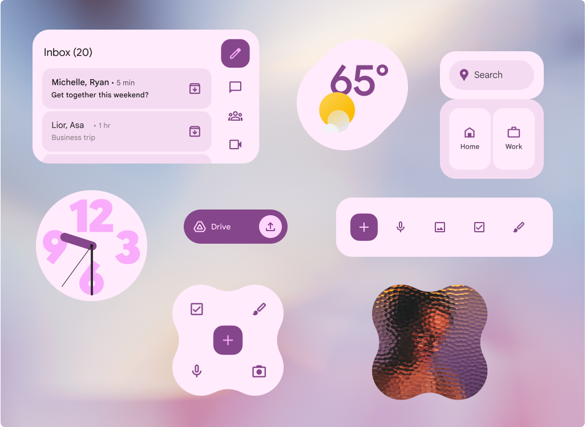
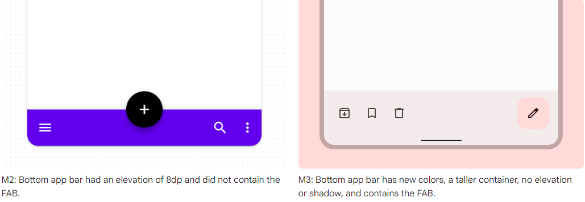
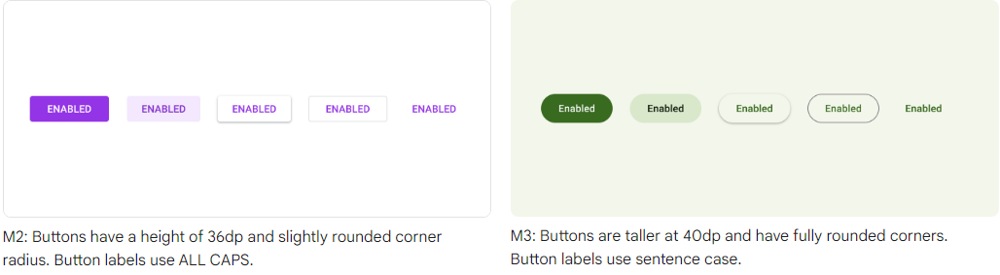

`Flutter 3.0 Version Release`  

2022년 5월 11일, Google I/O에서 Flutter 3.0.0 버전을 발표했다.  

Flutter로 앱을 개발한지 1년이 넘었고, 처음 1.12 버전을 사용하다가 1년이 살짝 더 지난 지금 3.0.0버전까지 보게 되었다.  

개인적으로 Flutter 생태계가 안정되지 않았던 때에 개발을 시작했기 때문에 이 프레임워크에 대해 불안감은 항상 존재하였다.  
또한, Google은 믿을만한 존재임과 동시에 믿지 못할 존재였다.~~말아먹은 프로젝트가 많다고 들었다..~~  

하지만 3.0.0 버전이 발표된 지금, Google이 강력하게 밀어주는 부분도 있지만 이 프레임워크가 한 순간 사라질 거란 불안감이 사라졌다.  

굉장히 빠른 속도로 업데이트가 되고 있고, 기존의 문제점들이 하나씩 개선되는 것을 보며 계속 주시를 해야겠다고 마음먹었다.  

처음에는 간편하며, trendy한 기술을 접해보자라는 마음에 flutter를 공부했는데 이놈 시장이 점점 커지고 있는 것 같다.  
시간이 조금 더 지나면 꽤 크게 자리잡을 것 같다는 생각이 든다.  

아래에서 내가 생각했던 `기존 버전의 문제점`과 `3.0.0 버전 이후 어떤 점이 달라졌는지`에 대해 알아보자.  

---

### 🦥 내가 생각한 문제점(3.0.0 Version이 나오기 전)  

💡 아래는 내가 처음부터 썼던 1.12 Version부터 현재 업데이트 전까지의 느낀점을 바탕으로 쓴 문제점이다.  
{: .notice--info}  

**1.** `native와 비교했을 때의 성능 한계점`  
이 부분은 어쩔 수 없는 것 같다.  
아직까진 동영상 플레이어, IoT 등 특정 기술에 대해선 native code로 작성해야하는 어려움이 존재한다.  

**2.** `짧은 역사`  
개발 관련 자료가 많지 않다.  
Issue에 부딪혀도 해결할 확률이 native보단 적음.  

**3.** `빠른 변화`  
개발하면서 겪었던 이슈.  
잦은 업데이트로 인해 migration을 해야한다는 점, 또 2.0 버전이 출시되었을 때, null-safety와 같은 부분에서는 진행하던 프로젝트를 다 업데이트 해야 하는 일이 일어날 수 있다.  
즉, 빈번한 변화에 따른 코드 수정이 필요함.    

**4.** `버려진 Plugin`  
이 문제 또한 겪었던 문제인데, plugin을 사용하다가 flutter 버전업이 되면서 못쓰게 되었다.   
동시에 plugin은 업데이트가 되지 않았기 때문에 다른 plugin을 사용해야만 했다.  

**5.** `Mac M1 칩 문제`  
2021년 인턴십 도중, 동료들에게 M1 칩에서 발생하는 이슈들이 존재하였다.  
느린 것도 느리고(Build, Integration Testing?) 특정 상황에서는 돌아가지 않는다는 소리를 들었었다.  
나는 당시 Windows를 사용하여 몰랐지만, M1을 사용하는 동료가 굉장히 힘들어했었다.  

**6.** `모바일 친화적`  
모바일 위주로 만들어진 프레임워크라는 것이 아쉬웠다.  
아래에서 다루겠지만, 이것도 옛날 얘기가 되어버렸다.  

**7.** `버려질 지 모른다는 두려움`  
현업에서 flutter는 스타트업 외에 잘 쓰지 않는다.  
기존 native로 이미 규모있게 작성한 앱을 다시 cross-platform으로 돌리긴 효율적이지 않기 때문이다.(아직 native와의 성능 한계점이나 구현의 한계점이 존재하기 때문)  
따라서 일자리도 flutter 개발 보단 native 개발이 많고, 아직 안정화가 되지 않았기에 불안함은 여전히 존재하는 것 같다.  

일단 당장 생각나는 문제점은 여기까지인 것 같다.  
다시 한 번 언급하지만, 이 문제점들은 3.0.0 Version이 업데이트 되기 전의 것들이다.  
Version Upgrade 후, 생각이 달라졌을지 아래에서 다뤄보자.  

---  

### 🦊 3.0.0 버전 이후 달라진 점  

#### 🐭 `공식 문서 링크`  

아래는 `공식 문서 링크` 이다.  
세부적인 설명들은 공식 문서를 참고하면 좋을 것 같다.  
`Google I/O`의 Youtube는 꼭 봤으면 한다.  

> [Google I/O](https://io.google/2022/products/flutter/intl/ko/)  
> [Google I/O Youtube(What's new in Flutter)](https://www.youtube.com/watch?v=w_ezWG1yKQQ)  
> [May 11, 2022, Google I/O Edition: Flutter 3 release](https://docs.flutter.dev/whats-new)  
> [Introducing Flutter 3](https://medium.com/flutter/introducing-flutter-3-5eb69151622f)  
> [What's new in Flutter 3](https://medium.com/flutter/whats-new-in-flutter-3-8c74a5bc32d0)  
> [Flutter 3.0.0 release notes](https://docs.flutter.dev/development/tools/sdk/release-notes/release-notes-3.0.0)  
> [Dart 2.17](https://medium.com/dartlang/dart-2-17-b216bfc80c5d)  
> [Introducing the Flutter Casual Games Toolkit](https://medium.com/flutter/announcing-the-flutter-casual-games-toolkit-c22e401d8fee)  
> [Google I/O Pinball Demo](https://pinball.flutter.dev/#/)  
> [Material 3](https://m3.material.io/)  

---  

#### 🐮 `Cross-Platform Support`  

**cross-platform**이라 함은 하나의 base 코드로 2개 이상의 플랫폼 빌드가 가능한 소프트웨어를 뜻한다.  
이번 3.0.0 Version부터 `Android`, `iOS`, `Web`, `Windows`, `MacOS`, `Linux` 총 6개의 platform build가 가능해졌다.  
(3.0.0 부터 `macOS`와 `Linux`를 **stable**하게 지원해줌!)  

  

---  

#### 🐯 `macOS의 System Menu Bar 지원`  

`PlatformMenuBar` 위젯을 이용, macOS Menu 항목을 컨트롤 가능.  
내가 mac을 안써봐서 대단한 기능인지 모르겠지만, 이러한 기능이 추가되었다고 한다.  
만약 내가 mac을 사용하는 유저였고, 이런 기능이 없었더라면 불편하긴 했었을 것 같다.  

  

---  

#### 🐰 `Universal binaries by default on macOS`  

Flutter 3.0.0 Version 부터, Flutter macOS Desktop App은 `Intel-based Macs`과 `Apple Silicon devices` 를 모두 지원해주도록 만들어졌다.  

#### 🐲 `Apple Silicon의 완벽한 지원`    

<u>Apple Silicon</u> 이란?  
Apple의 최신 하드웨어를 지원하는 새로운 프로세서 아키텍처.  
-> Apple이 설계한 칩 system과 processor  

기존에는 Apple Silicon을 완벽하게 directly 지원해주는 것이 아닌, Rosetta 등을 통해 지원해주고 있었다.  
하지만 완벽한 지원으로 바뀌게 되며, build시 ARM 칩을 지원하는 빌드를 따로 해주고 Apple Silicon에서 기본적으로 실행이 된다. 따라서, 전반적으로 속도가 향상된다.  

  

위 실험을 보았을 때, 기본 Intel 칩과 비교하여 Silicon 칩에서 3배정도 속도가 향상된 것을 볼 수 있다.  

> <i>Two developer journeys matter to Apple silicon: how to use those machines as your development environment and how to compile binaries in the ARM 64-bit architecture. Hence, they run natively on Apple silicon.</i>  
> <i>You’ll no longer need to rely primarily on Rosetta translation when analyzing or compiling code for the Flutter app.</i>  

---  

#### 🐍 `Linux application 지원`  

각 플랫폼마다 Design Style이 약간씩 다르다.  
예를 들어, Android는 `Material Design`을 사용, iOS는 `Cupertino`를 사용하는데, 이번 버전부터 Linux에 대한 Design이 추가되었다.  
Linux는 yaru를 이용하여 linux만의 design style을 표현한다.      
Pub.dev에서 `yaru`를 패키지로 제공하고 있고, 그 밖에도 linux에 필요한 플러그인들(dbus, gsettings, bluetooth, desktop_notifications 등)을 지원해준다.   

> [yaru (pub.dev)](https://pub.dev/packages/yaru)   

---  

#### 🐴 `Foldable device support`  

이제는 폴더블 device도 지원해준다.  
`MediaQuery`의 속성이 추가되었다.(접힌 여부, 잘린 여부 등의 상태 추가됨)  
폴더블 핸드폰이 나오면서 앱 front에 대해 고민을 해 본 적이 있는데, 한 번 실험을 해봐야 할 것 같다.  
하지만 이런식으로 foldable phone에 대해서도 기능을 만들어준다면 개발자야 땡큐다.  

  
 
---  

#### 🐑 `Web 기능 향상`  

**1.** Flutter framework, engine, contents 로딩을 제어할 수 있는 new API 추가  

이것은 web 상에서 headless mode로 flutter를 실행할 수 있게 해준다.  
즉, 로그인 화면 혹은 진행률 바(달성률 바)를 표시하는 동안 이 API가 flutter 앱을 미리 load하게 할 수 있다.  

**2.** Image Decoding 성능이 개선됨  

아래는 `Google I/O`에서 실행한 `GIF Animation의 Stress Test`이다.  
좌측이 `old image decoding`이고, 우측이 `new image decoding`이다.  
좌측은 스크롤링이나 image를 불러오는 데에 버벅거림이 존재하는 반면, 우측은 쓰무쓰하다.  

  

---  

#### 🐵 `Firebase 공식 지원`  

3.0.0 Version이후,  
Firebase Console에서 flutter가 공식 지원되는 것을 볼 수 있다!  
Flutter와 firebase 연동(셋팅)이 훨씬 간편해졌다고 한다.  

  

---

#### 🐔 `Support Material Design 3`  

Flutter 3.0.0 Version에선 Material Design 3을 지원한다.  
자세한 건 공식 문서를 참고하자.  
여기서는 맛보기로 몇 가지 사진들을 첨부하겠다.  

  
  
  
  

---  

#### 🐶 `Dart 2.17`  

Flutter Language인 Dart가 2.17로 업데이트 되었다.  
크게 바뀐 부분은 아래와 같다.  
- `Enhanced enums with members`  
- `Super initializers`    
- `Named args everywhere`  

더 자세한 것은 공식 문서를 보자.  

---  

#### 🐷 `Casual Games Toolkit`  

Flutter 공식 게임 툴킷이 추가되었다.  
당장은 완벽한 기능을 기대하긴 어렵지만, 게임 툴킷과 관련 문서들이 추가되었으니 관심있으면 찾아보길 바란다.  
개인적인 생각이지만, 미래를 바라봤을때도 flutter로 정교한 게임을 만든다는 것은 어렵지 않을까? 라는 생각을 해본다.  
물론 이 생각도 다음 버전 다다음 버전이 나올 때 쯤이면 바뀔지도 모른다.  

아래는 flutter로 만든 pinball game demo 버전이다.  
직접 해보려면 아래 링크를 통해 들어가보길 권장한다.  
[Google I/O Pinball](https://pinball.flutter.dev/#/)  

  

---  

### 🦅 끝으로..

이 밖에 다양한 기능이 추가되고 개선되었다.  
이 포스팅에 담기지 않은 많은 내용들은 공식 문서에서 찾아볼 수 있다!  

다시 한 번 말하지만, 이번 업데이트부터 flutter는 굉장히 강력해졌다고 볼 수 있다.  
슬슬 안정적으로 자리를 잡아가고 있다는 말이다.  
Google이 개인적으로 미래를 보고 언어나 프레임워크 등을 본인 회사들 것을 쓰게끔 만들고 있는 것 같다.  
굉장히 야망있는 친구들이다..   

1년 뒤엔 또 어떻게 바뀔까 기대되기도 하며 머지 않아 크게 한따까리 할 것 같다는 생각이 든다.  

앞으로 Google I/O를 지켜보며 업데이트에 반응해야겠다.  