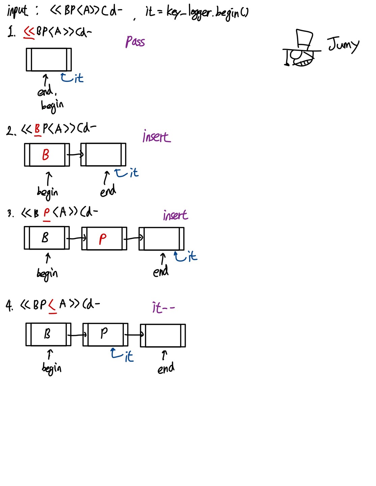
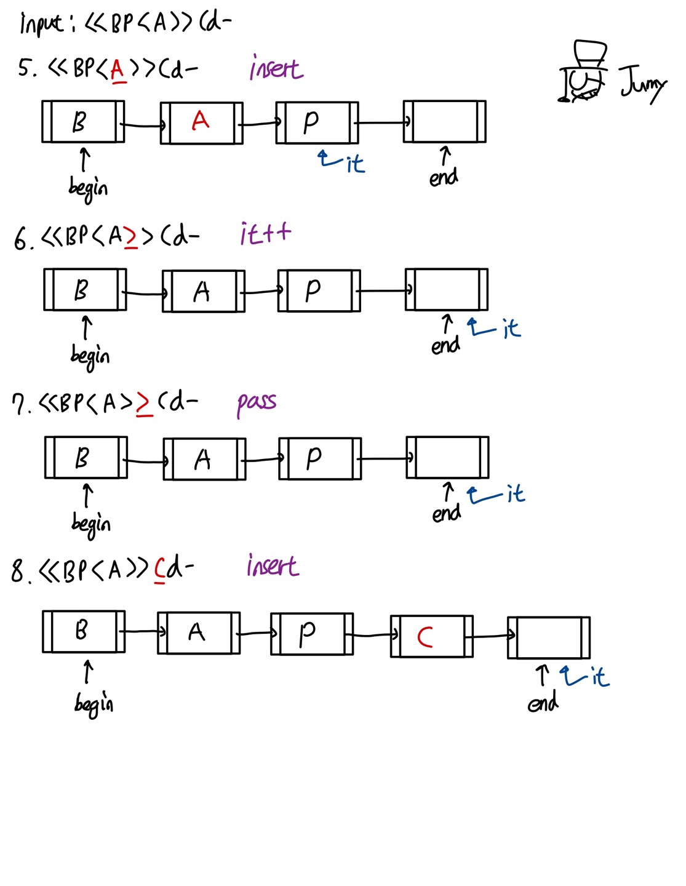
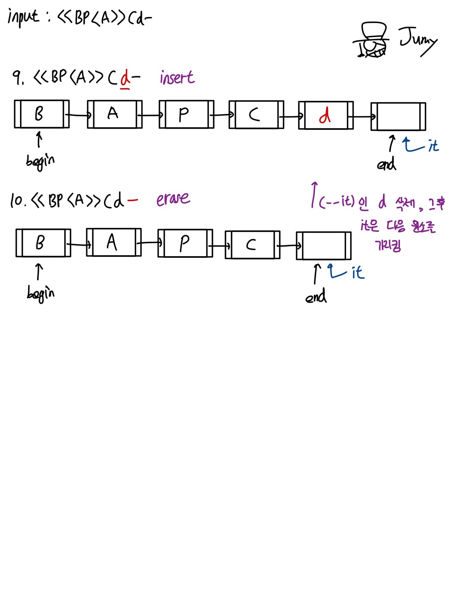

`백준 5397번 - 키로거`  

> [백준 5397번](https://www.acmicpc.net/problem/5397)  

#### ❓ 문제

창영이는 강산이의 비밀번호를 훔치기 위해서 강산이가 사용하는 컴퓨터에 키로거를 설치했다. 며칠을 기다린 끝에 창영이는 강산이가 비밀번호 창에 입력하는 글자를 얻어냈다.  

키로거는 사용자가 키보드를 누른 명령을 모두 기록한다. 따라서, 강산이가 비밀번호를 입력할 때, 화살표나 백스페이스를 입력해도 정확한 비밀번호를 알아낼 수 있다.   

강산이가 비밀번호 창에서 입력한 키가 주어졌을 때, 강산이의 비밀번호를 알아내는 프로그램을 작성하시오. 강산이는 키보드로 입력한 키는 알파벳 대문자, 소문자, 숫자, 백스페이스, 화살표이다.  

> 예제 입력  
> 2  
> `<<BP<A>>Cd-`  
> `ThIsIsS3Cr3t`  

> 예제 출력  
> BAPC  
> ThIsIsS3Cr3t  

---  

#### ✏️ Stack을 이용한 풀이

먼저, `Stack`을 이용한 풀이이다.  
두 개의 stack을 이용한다.  
하나는 `key_logger_stack` 이고, 하나는 `'<','>'`의 방향키를 담아 줄 `arrow stack`이다.  

`해법`  

🔥 모든 스택은 empty()를 이용하여 비었는지 등을 체크해준다.  
{: .notice--warning}  

**case 1:** key_logger_stack이 empty()가 아닐 때 `'<'`를 발견하면 `key_logger_stack.top()`을 `arrow stack`에 <u>push</u>한다.  
그 후, `key_logger_stack.pop()`을 한다.  

**case 2:** arrow_stack이 empty()가 아닐 때 `'>'`를 발견하면 `arrow_stack.top()`을 `key_logger_stack`에 <u>push</u>한다.  
그 후, `arrow_stack.pop()`을 한다.  

**case 3:** key_logger_stack이 empty()가 아닐 때 `'-'`를 발견하면 `key_logger_stack.pop()`을 한다.  

**case 4:** 그 외의 경우는 문자이므로 `key_logger_stack.push`를 한다.  

여기까지 했을 때, 반례가 존재한다.  

ex)  
input : `<<BP<A`  
output : BA  
-> arrow_stack에 A P가 남아있음.  

따라서, 마지막에 `arrow_stack`에 남아있는 모든 원소를 `key_logger_stack`에 push해주면 된다.  

`예제 입력1 해결 과정`  

input : `<<BP<A>>Cd-`  

**1.**  

**현재 문자** : `<<`  
남은 문자 : `BP<A>>Cd-`  

key_logger_stack이 empty()이기 때문에, pass  

key_logger_stack = []  
arrow_stack = []  

**2.**  

**현재 문자** : `BP`  
남은 문자 : `<A>>Cd-`  

문자는 바로 key_logger_stack에 push  

key_logger_stack = [B P]  
arrow_stack = []  

**3.**  

**현재 문자** : `<`  
남은 문자 : `A>>Cd-`  

key_logger_stack이 empty()가 아니기 때문에 key_logger_stack에서 pop, arrow_stack에서 push가 이루어짐.  

key_logger_stack = [B ]  
arrow_stack = [P ]  

**4.**  

**현재 문자** : `A`  
남은 문자 : `>>Cd-`  

문자는 바로 key_logger_stack에 push  

key_logger_stack = [B A]  
arrow_stack = [P ]  

**5.**  

**현재 문자** : `>>`  
남은 문자 : `Cd-`  

arrow_stack이 empty()가 아니기 때문에 arrow_stack에서 pop, key_logger_stack에서 push가 이루어짐.  

key_logger_stack = [B A P]  
arrow_stack = [ ]  

**6.**  

**현재 문자** : `Cd`  
남은 문자 : `-`  

문자는 바로 key_logger_stack에 push  

key_logger_stack = [B A P C d]  
arrow_stack = [ ]  

**7.**  

**현재 문자** : `-`  
남은 문자 : `없음`  

key_logger_stack이 empty()가 아니기 때문에, key_logger_stack에서 pop()이 이루어짐.  

key_logger_stack = [B A P C]  
arrow_stack = [ ]  

**8.**  

최종적으론 이 stack을 전부 꺼내서 vector<char>에 넣고 reverse를 해도 되고, 나는 stack을 한개 더 써서 다시 넣었다 빼는 쪽으로 reverse를 구현하였다.  

---

#### ✔️ stack 정답 코드

```cpp
#include <iostream>
#include <vector>
#include <stack>
#include <algorithm>

using namespace std;

void key_logger(string word);
void reverse_output(stack<char> original_stack);

int main(void) {
  ios_base::sync_with_stdio(0);
  cin.tie(0);
  cout.tie(0);

  int T;
  cin >> T;

  for (int i=0; i<T; i++) {
    string temp;
    cin >> temp;
    key_logger(temp);
  }
  
  return 0;
}

void key_logger(string word) {
  stack<char> key_logger_stack;
  stack<char> arrow;
  for (int i=0; i<word.length(); i++) {
    switch (word[i]) {
      case '<':
        if (!key_logger_stack.empty()) {
          arrow.push(key_logger_stack.top());
          key_logger_stack.pop();
        }
        break;
      case '>':
        if (!arrow.empty()) {
          key_logger_stack.push(arrow.top());
          arrow.pop();
        }
        break;
      case '-':
        if (!key_logger_stack.empty())
          key_logger_stack.pop();
        break;
      default:
        key_logger_stack.push(word[i]);
        break;
    }
  }

  while(!arrow.empty()) {
    key_logger_stack.push(arrow.top());
    arrow.pop();
  }
  
  reverse_output(key_logger_stack);
}

void reverse_output(stack<char> original_stack) {
  stack<char> reverse_stack;
  while(!original_stack.empty()) {
    reverse_stack.push(original_stack.top());
    original_stack.pop();
  }

  while(!reverse_stack.empty()) {
    cout << reverse_stack.top();
    reverse_stack.pop();
  }
  cout << "\n";
}
```  

---  

#### ✏️ STL list를 이용한 풀이

`Linked list`를 이용한 풀이이다.  

커서를 이동하며 중간에 삽입, 삭제 과정이 일어난다는 점에서 list를 사용하면 더욱 쉽게 해결할 수 있다.  

`풀이`  

커서의 이동에 대한 부분을 `list<char>::iterator`의 이동으로 구현할 것이다.  

list<char> key_logger;
list<char>::iterator it = key_logger.begin();
인 상태에서 시작.  

**case 1:** `<`이 나오면서 iterator가 list.begin()이 아닐 경우, 커서를 왼쪽`(iterator--)`으로 이동  

**case 2:** `>`이 나오면서 iterator가 list.end()가 아닐 경우, 커서를 오른쪽`(iterator++)`으로 이동  

**case 3:** `-`이 나오면서 iterator가 list.begin()이 아닐 경우, iterator = list.erase(it)  

💡 list.erase 함수는 현재 iterator가 가리키는 항목을 지우고, 삭제한 원소의 다음을 가리키는 iterator를 반환함.  
{: .notice--info}  

**case 4:** 위 3개의 단어가 입력이 아닐 때, 현재 iterator에 원소를 삽입(insert)   

💡 list.insert 함수는 list.insert(it, w)로 사용함.   
현재 it이 가리키는 항목에 w를 insert하고, 삽입한 원소를 가리키는 iterator를 반환함.  
{: .notice--info}  


> ++ 왜 case 4에 else를 넣지 않았냐면, else로 처리할 경우 특정 상황에서 <, >, -가 들어가기 때문에 else if로 처리함.  

`예제 입력1 해결 과정`  

글 보단 그림! 그림으로 설명하겠다.  

그림을 보여주기 앞서, insert와 erase 그리고 iterator의 위치가 중요한 문제였다.  
list의 원리를 잘 알고 있다면 수월하게 풀 수 있었다.  
~~물론 난 시간이 좀 걸렸다..~~  
여기서 중요한 점은, `insert 함수`는 현재 iterator가 가리키는 위치에 원소를 삽입하는 함수이지만, 아래 그림처럼 현재 iterator 전에 삽입한다고 이해하면 쉬울 것이다.  
`erase 함수`는 현재 iterator가 가리키는 원소를 지우고 iterator는 다음 원소로 옮겨진다.  

말이 너무 길어졌다.  
아래는 그림으로 나타낸 예제 입력1의 해결 과정이다.  

  
  
  

---  

#### ✔️ STL list 정답 코드  

```cpp
#include <iostream>
#include <string>
#include <list>

using namespace std;

void key_logger_answer(string word);

int main(void) {
	ios_base::sync_with_stdio(0);
	cin.tie(0);
	cout.tie(0);

	int T;
	cin >> T;
	for (int i = 0; i < T; i++) {
		string temp;
		cin >> temp;
		key_logger_answer(temp);
	}

	return 0;
}

void key_logger_answer(string word) {
	list<char> key_logger;
	list<char>::iterator it = key_logger.begin();

	
	for (int i = 0; i < word.length(); i++) {
		if (word[i] == '<' && it != key_logger.begin())
			it--;
		else if (word[i] == '>' && it != key_logger.end())
			it++;
		else if (word[i] == '-' && it != key_logger.begin())
			it = key_logger.erase(--it);
		else if (word[i] != '<' && word[i] != '-' && word[i] != '>')
			key_logger.insert(it, word[i]);
	}
	
	for (it = key_logger.begin(); it != key_logger.end(); it++)
		cout << *it;
	cout << "\n";
}
```  
