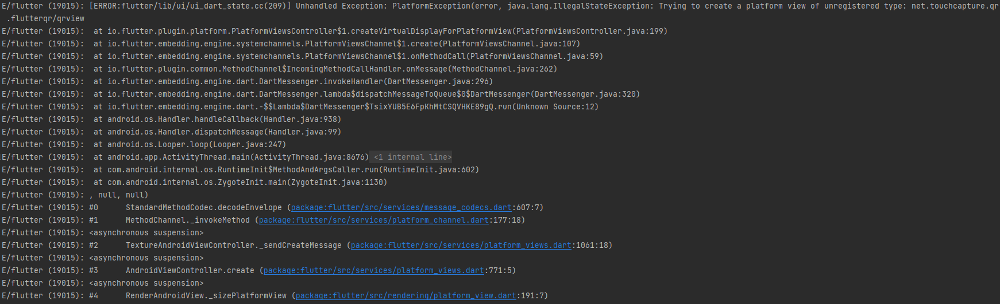

---
title: "[Flutter] qr_code_scanner plugin 에러 해결"
excerpt: "QR 스캔을 위한 qr_code_scanner 플러그인 에러"

categories:
  - Flutter
tags:
  - [Flutter]

permalink: /flutter/flutter-qr-code-scanner/

toc: true
toc_sticky: true
toc_label: "Contents"
toc_icon: "lightbulb" # https://fontawesome.com/
 
date: "2022-06-23 10:00:00"
last_modified_at: "2022-06-23 10:00:00"
published: true

---  

### ✏️ QR Code Scanner

인턴십에서 Flutter를 이용한 앱을 만들었고, 그 중 하나의 기능인 QR Code 스캔 기능에 문제가 생겼다.  
3개월? 전에 만들었던 프로그램의 통합 테스트를 위해 이것 저것 테스트를 하다가, 새로 판 프로젝트에서 QR Code Scan이 되지 않아 당황했다.  

우선 사용했던 플러그인은 아래에서 찾을 수 있다.  
> [qr_code_scanner](https://pub.dev/packages/qr_code_scanner)  

참고로 `qr_code_scanner: ^0.7.0` 버전을 사용하였다.  

---  

#### 🙄 처음 직면했던 에러  

`Unhandled Exception: PlatformException blah~blah~`  

<a href="https://kdjun97.github.io/assets/images/post_img/flutter-qr-code-scanner/error.png">
  
</a>

내용을 좀 더 보았을 땐, qr_code_scanner의 qr_view 부분이 문제가 있다는 message였다.  
왜 안될까 하고 열심히 구글링을 하던 도중, 셋팅법이 따로 있었던가? 하는 의문점에 다시 [pub.dev](https://pub.dev/)으로 향했다.  

다시 찬찬히 보니 친절하게 pub.dev에서 `Android Integration`에 minSdk를 바꾸라고 나와있었다.  

```
In android/app/build.gradle change defaultConfig{ ... minSdkVersion 16 } to defaultConfig{ ... minSdkVersion 20 }
```  

`android/app` 경로에서 `build.gradle` 의 <u>minSdkVersion</u>을 `20`으로 바꾸어주니 해결됐다.  

`build.gradle`  

```gradle
defaultConfig {
    applicationId "com.example.workout_management"
    minSdkVersion 20 //flutter.minSdkVersion
    targetSdkVersion flutter.targetSdkVersion
    versionCode flutterVersionCode.toInteger()
    versionName flutterVersionName
}
```  

---   

#### 😂 후에 알게된 사실.  

minSdkVersion을 20 미만으로 설정하고 build를 하였을 때, 아래와 같은 메시지가 뜬다.  

```
C:\Users\USER\AndroidStudioProjects\workout_management\android\app\src\debug\AndroidManifest.xml Error:
   uses-sdk:minSdkVersion 16 cannot be smaller than version 20 declared in library [:qr_code_scanner] C:\Users\USER\AndroidStudioProjects\workout_management\build\qr_code_scanner\intermediates\library_manifest\debug\AndroidManifest.xml as the library might be using APIs not available in 16
   Suggestion: use a compatible library with a minSdk of at most 16,
      or increase this project's minSdk version to at least 20,
      or use tools:overrideLibrary="net.touchcapture.qr.flutterqr" to force usage (may lead to runtime failures)

FAILURE: Build failed with an exception.

* What went wrong:
Execution failed for task ':app:processDebugMainManifest'.
> Manifest merger failed : uses-sdk:minSdkVersion 16 cannot be smaller than version 20 declared in library [:qr_code_scanner] C:\Users\USER\AndroidStudioProjects\workout_management\build\qr_code_scanner\intermediates\library_manifest\debug\AndroidManifest.xml as the library might be using APIs not available in 16
     Suggestion: use a compatible library with a minSdk of at most 16,
        or increase this project's minSdk version to at least 20,
        or use tools:overrideLibrary="net.touchcapture.qr.flutterqr" to force usage (may lead to runtime failures)

* Try:
Run with --stacktrace option to get the stack trace. Run with --info or --debug option to get more log output. Run with --scan to get full insights.

* Get more help at https://help.gradle.org

BUILD FAILED in 5s
```

실제로는 위와 같은 에러를 직면한 것이다. 아주 간단히 minSdkVersion을 20으로 바꾸라고 설명되어있음.  

하지만, 나의 상황은 이랬었다.  
1. 이미 minSdkVersion 16으로 debug mode run  
1. 잘 작동되고 있는 와중에 HOT RELOAD기능으로 QR Scanner Widget을 넣음
1. QR Scanner도 스캔 부분 빼곤 작동을 잘 함
1. 스캔 부분에서는 SdkVersion문제로 스캔이 안됨 (20이상이여야하는데 16으로 실행했기 때문)
1. 처음부터 16버전으로 QR scanner를 build하였으면 BUILD FAILED가 떴겠지만, HOT RELOAD로 중간에 QR Widget을 삽입했기 때문에 BUILD 당시 에러는 없음
1. UI가 보이는데 왜 스캔이 안되는거지? 뭐가 문제지? 하는 이슈 발생

결국 plugin 셋팅에 대한 부분을 잘 읽었거나, 프로젝트 build를 아예 다시 했으면 됐을 문제였다..  

30분? 1시간?을 이 문제때문에 헤맸던 것 같다.  
이번에도 지원이 중단되었나? 안드로이드 버전 문제인가? 하면서 많은 생각을 하였고, 맥빠지게 해결책은 가까이에 있었다.  

플러그인 사용시 usage 같은 부분들을 잘 봐야겠다고 다시 다짐한다.  
또한, 프로젝트 중간에 새로운 plugin을 사용할 때, 에러가 나면 아예 재시작하는 방법을 먼저 시도해보자.  