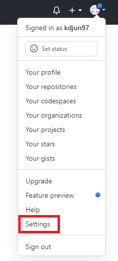
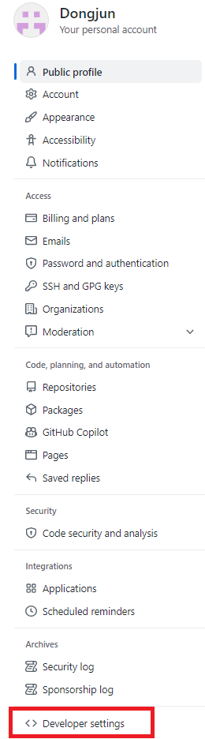
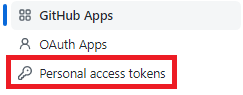
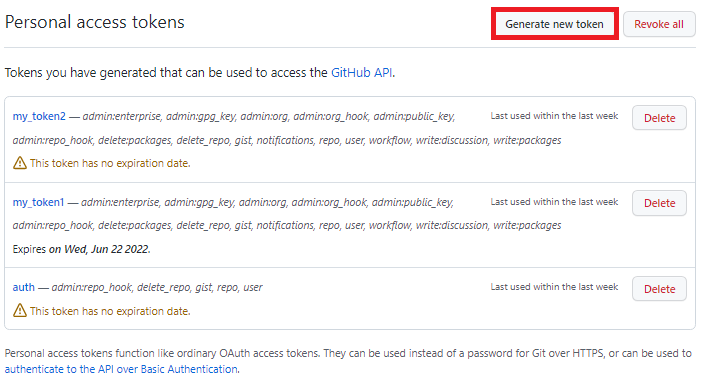
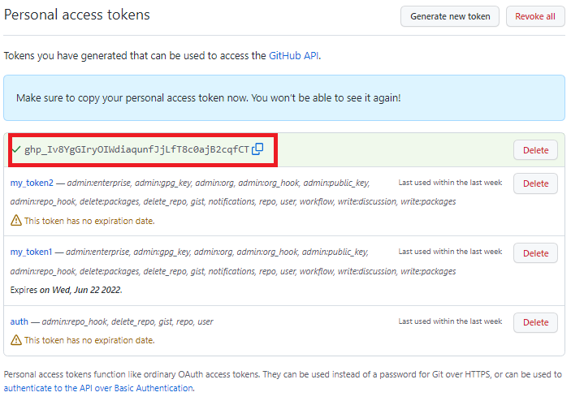
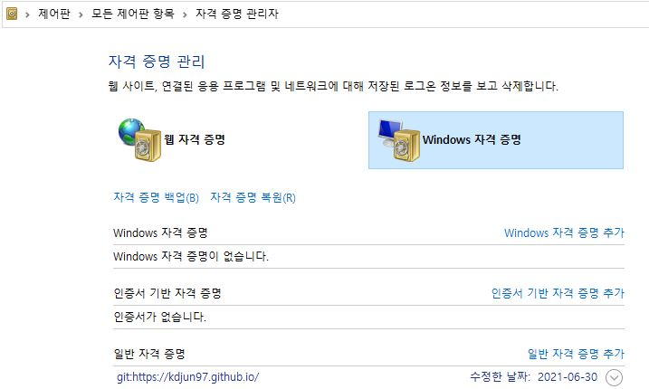
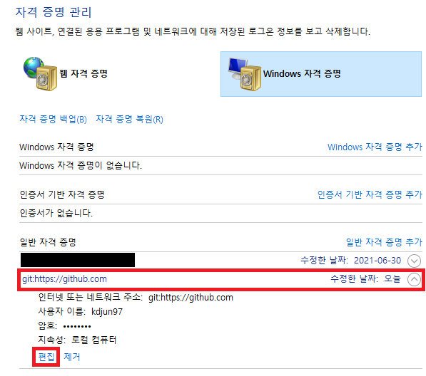
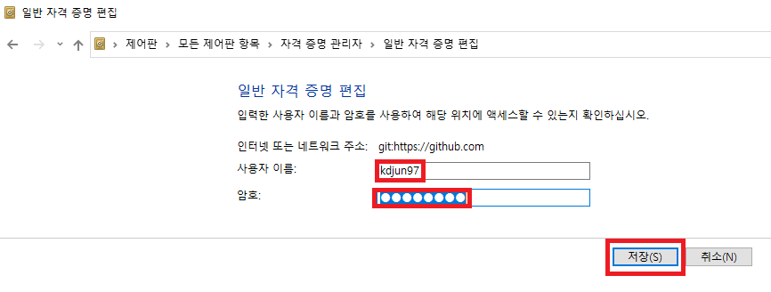

## 😂 Github 로그인 방식 변경

**remote: Support for password authentication was removed on August, 13, 2021.**  
2021년 8월 13일부로 인증 방식이 `password -> token`방식으로 바뀌었다.  

기존에 로그인 되어있었던 계정이나 혹은 새로 만든 repo에 push를 할 때, `fatal repository not found error` 이러한 에러가 뜬다면 token방식으로 로그인이 되어있는지 확인해볼 필요가 있다.  

바뀐 정책에 따라 아래에서는 token을 이용하여 authentication 인증을 하는 법을 알아볼 것이다.  
참고로 `Windows` 환경에서 진행하였다.  

---  

## 🔐 Token을 이용하여 auth 인증

1. Github 홈페이지 - User Profile - Settings 클릭  
-   
1. Developer settings 클릭
-      
1. Personal access tokens 클릭
-      
1. Generate new token 클릭
-      
1. 아래와 같이 기입 후 녹색 Generate token 버튼 클릭
  - Note : 토큰 이름(알아보기 쉬운 것 추천)
  - Expiration : 토큰 만료 기한 (적절한 기간 선택)
  - Select Scopes : repo 전체 체크 + admin:repo_hook 전체 체크 (보통의 경우)
1. 토큰 기억(이 페이지를 나가면 다시는 못 보기 때문에 반드시 메모)
-      
1. Windows 검색 -> 자격 증명 관리자(제어판) 이동
-      
1. 일반 자격 증명 - github.com 편집
-      
1. 설정
- 사용자 이름 : 깃허브 아이디
- 암호 : 아까 메모해뒀던 토큰
-      

이렇게 설정한 뒤, push를 하면 정상적으로 작동이 될 것이다.  