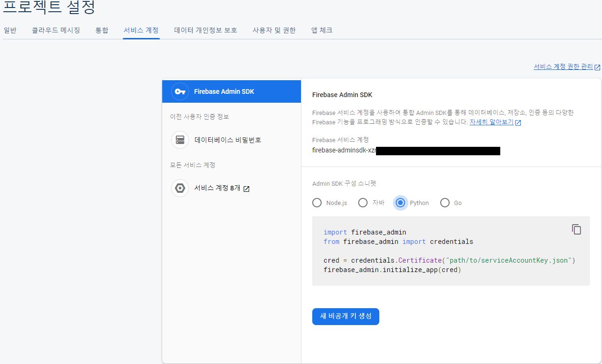
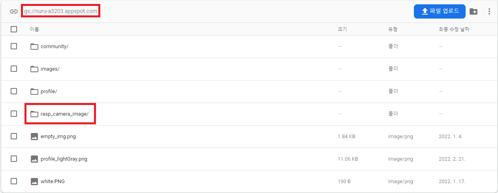
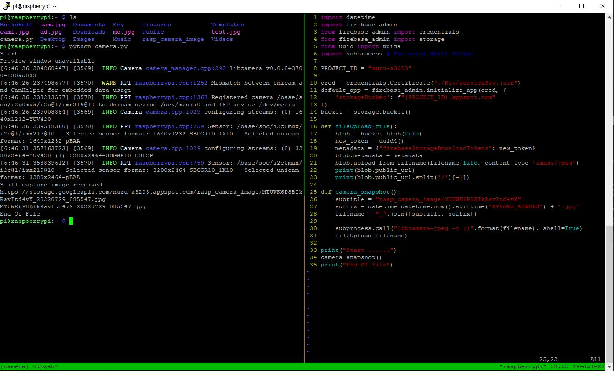
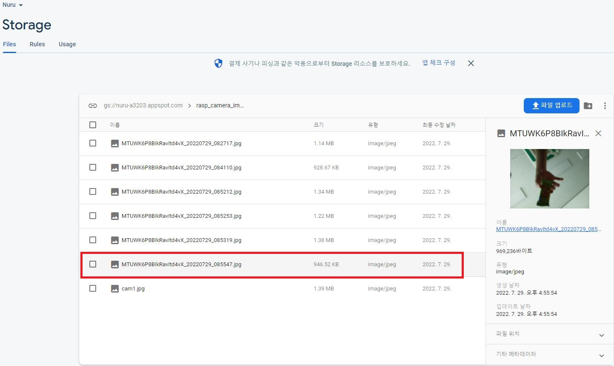

## 🔧 개발환경

Python 3.9.2  
Firebase  
Raspberry Pi 4 8GB RAM  
카메라 모듈 V2, 8MP (RPI 8MP CAMERA BOARD)  
Rasberry Pi OS (64-bit) (Debian Bullseye)  

---

## 🔥 Firebase 연동

`Nuru Project`에서 라즈베리파이와 카메라를 연동하는 기능이 필요했다.  
또한, firebase에 사진을 올리는 작업 역시 필요했다.  
따라서 그 기능들을 구현해보자.  

우선, firebase에 라즈베리파이를 연동하는 작업부터 시작해볼 것이다.  

**1.** `Firebase Console`에서 자신의 프로젝트를 선택한다.  
나는 프로젝트가 이미 있기 때문에, 기존 프로젝트를 선택!  

**2.** 프로젝트 개요 -> 프로젝트 설정 -> 서비스 계정  

**3.** Admin SDK 구성 스니펫 `Python 선택`, 새 비공개 키 생성  
  

**4.** 다운된 키 파일을 라즈베리파이에 옮겨야함.  
FileZilla를 이용하자.  
나는 Key라는 폴더에 serviceKey.json로 이름을 바꾸어 넣었다.  
> [참고 : 라즈베리파이 Filezilla 이용](https://kdjun97.github.io/iot/raspberry-pi-filezilla/)  

**5.** Firebase Storage에 폴더 생성  
`project_id(nuru-a3203)` 기억해놓기.  
<a href="https://kdjun97.github.io/assets/images/post_img/iot/raspberry-pi-firebase-storage/project_id.png">
  
</a>

---  

## 🍓 라즈베리파이 셋팅

**1.** Firebase Admin SDK 설치를 위해 pip install  
`$ sudo pip3 install firebase-admin`  

**2.** uuid Module 설치 (UID를 생성하기 위함)  
`$ sudo pip3 install uuid`  

---  

## 🐍 파이썬 코드 작성(Storage 연결 및 쓰기)  

> [Github Open Source 참고](https://github.com/reasley-com/lecuture-iot-computing/blob/main/Series3_Camera(FireStorage)/Storage_camera.py)  

OpenCV를 사용하는 방법도 있을 것이고, 카메라를 사용하는 방법은 많을 것이다.  
하지만 제일 간단한 방법인 `shell script`를 이용하여 이미 지원해주고 있는 `libcamera`를 사용하였다.  

```python
import datetime
import firebase_admin
from firebase_admin import credentials
from firebase_admin import storage
from uuid import uuid4
import subprocess # For using Shell Script

PROJECT_ID = "nuru-a3203" # Owner Project ID

cred = credentials.Certificate("./Key/serviceKey.json") # Service Key Path

default_app = firebase_admin.initialize_app(cred, {
    'storageBucket': f"{PROJECT_ID}.appspot.com"
})
bucket = storage.bucket()

def fileUpload(file):
    blob = bucket.blob(file)
    new_token = uuid4()
    metadata = {"firebaseStorageDownloadTokens": new_token}
    blob.metadata = metadata
    blob.upload_from_filename(filename=file, content_type='image/jpeg')
    print(blob.public_url) # Storage path print
    print(blob.public_url.split('/')[-1])

def camera_snapshot():
    subtitle = "rasp_camera_image/MTUWK6P8BIkRavItd4vX" # 직접 지정해준 Directory/UID
    suffix = datetime.datetime.now().strftime("%Y%m%d_%H%M%S") + '.jpg' # 현재시간
    filename = "_".join([subtitle, suffix]) # 둘을 '_' 기준으로 합침
    subprocess.call("libcamera-jpeg -o {}".format(filename), shell=True) # Shell Script 실행 (libcamera 이용)
    fileUpload(filename)

print("Start ......")
camera_snapshot()
print("End Of File")
```

간단히 사진을 찍고, 미리 만들어 둔 Storage에 사진을 올리는 작업이다.  
위에서 사진 명은 UID를 지정해서 붙여주었다.  
올라간 Path에서 file 명만 분리한 string도 출력하고 있다.  

---

## 📸 결과

`Python 코드 실행 모습`  
<a href="https://kdjun97.github.io/assets/images/post_img/iot/raspberry-pi-firebase-storage/ok.JPG">
  
</a>

`Storage 사진`  
<a href="https://kdjun97.github.io/assets/images/post_img/iot/raspberry-pi-firebase-storage/picture.JPG">
  
</a>

이제 `Cloud FireStore Database`에 path를 넣어주는 작업이 남았다.  
> [다음 글 : 라즈베리파이4, Cloud Firestore 사용하기](https://kdjun97.github.io/iot/raspberry-pi-cloud-firestore/)  

💡 과자를 들고 찍은 사진이다. 심령 사진이 아님을 알린다.  
{: .notice--info}   