## 🖼️ OpenCvSharp4 설치

`OpenCV(Open Source Computer Vision)`: 이미지 처리 오픈소스 라이브러리.  
이번 포스팅에서는 이미지 처리, 영상 처리에 사용되는 OpenCV를 설치해볼 것이다.  
툴은 `Visual Studio 2017`을 사용하였다.  

이 포스팅을 끝까지 따라한다면, 자신의 프로젝트에서 <u>에러없이</u> **OpenCvSharp**를 사용할 수 있게 될 것이다! 시작해보자!  

**1.** 우선 새 프로젝트를 하나 판다.  

나는 **빈 프로젝트**를 선택하였다. **Windows Form** 등을 사용해도 무방하다.  

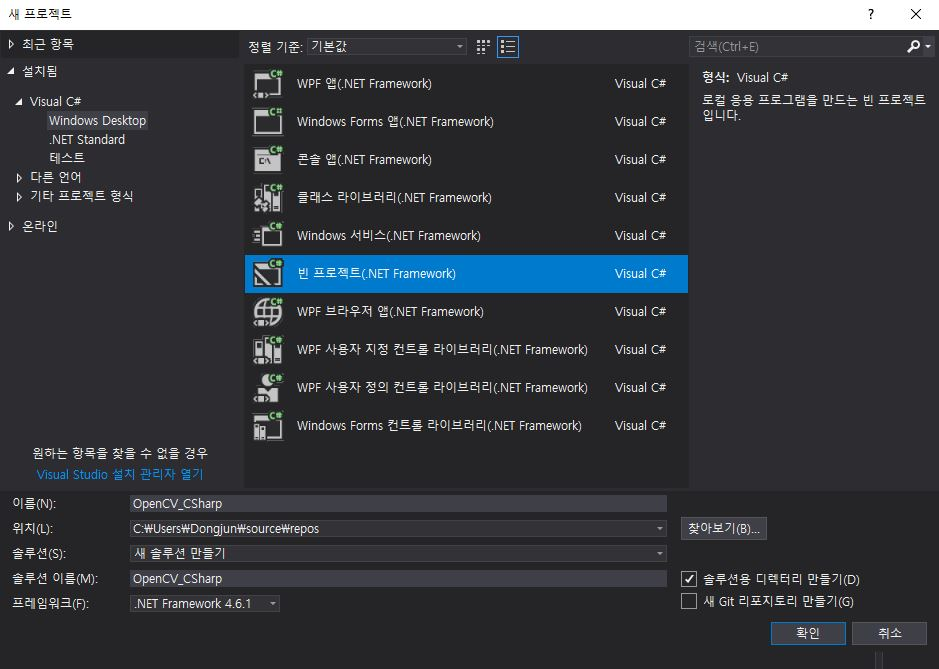  

**2.** 프로젝트 - `Nuget` 패키지 관리 클릭  

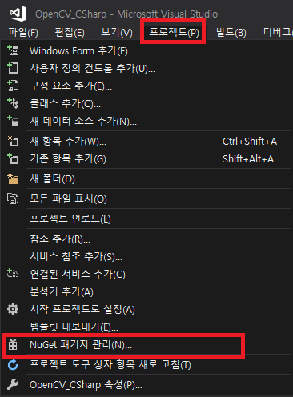  

**3.** 찾아보기 - `opencvsharp` 검색  
`OpenCvSharp4` 찾아서 클릭, 안정적인 버전 찾아서 오른쪽에 설치 버튼 클릭  
보통, 그냥 OpenCvSharp4를 찾으면 안정적인 버전이 뜸.  
바로 설치를 누르면 됨.  

<a href="https://kdjun97.github.io/assets/images/post_img/computer-vision/opencv-csharp-install/opencvsharp.png">
  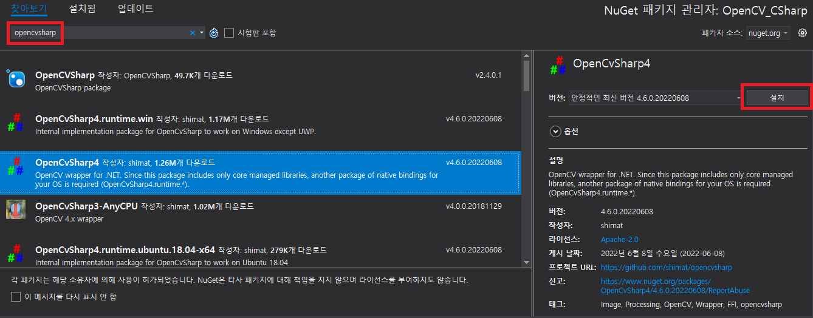
</a>

**4.** 확인 메시지 뜨면 확인  

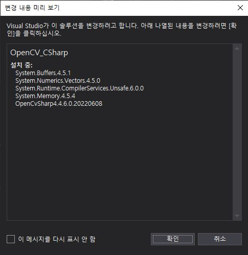  

**5.** 소스코드 작성 후 실행  

```cpp
using OpenCvSharp;

namespace OpenCV_CSharp
{
    class CVTest
    {
        static void Main()
        {
            Mat img = Cv2.ImRead(@"lena.png", ImreadModes.Color);
            Cv2.ImShow("img", img);
            Cv2.CvtColor(img, img, ColorConversionCodes.BGR2GRAY);
            Cv2.ImShow("gray_img", img);
            Cv2.WaitKey(0);
            Cv2.DestroyAllWindows();
        }
    }
}
```  

**6.** 에러 발생  
여기까지 하고 코드를 실행하면 에러가 발생한다.  
Exception: **System.TypeInitialization: "OpenCvSharp Internal NativeMethods...**  
에러를 잘 읽어보면, `DLL OpenCvSharpExtern`을 로드할 수 없다고 나온다.  

<a href="https://kdjun97.github.io/assets/images/post_img/computer-vision/opencv-csharp-install/exception.JPG">
  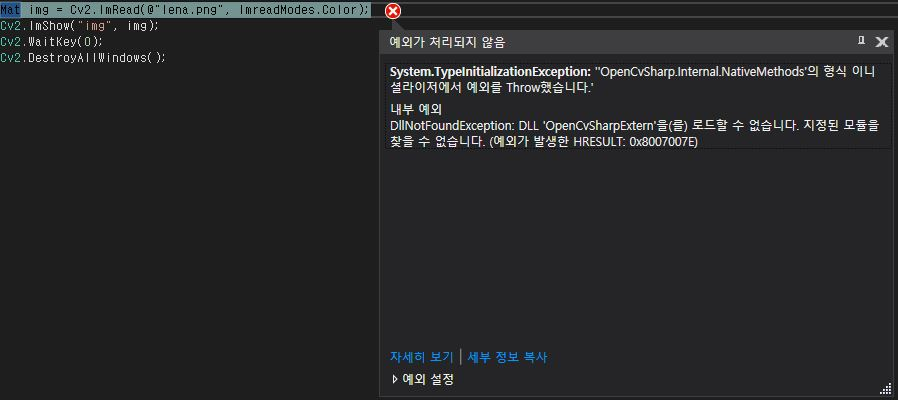
</a>

---  

## 🔗 DLL Load 에러 해결

바로 직전의 에러는 `Load할 Dll이 없어서 나는 에러`이다.  
즉, `OpenCvSharpExtern.dll`을 프로젝트에 넣어주고 설정해주면 해결된다.  
그 과정을 다뤄보자.  

**1.** 아래의 링크로 가자.  

[Github Link](https://github.com/shimat/opencvsharp)  

**2.** 우측에 `Releases` 아래 태그를 누르자  

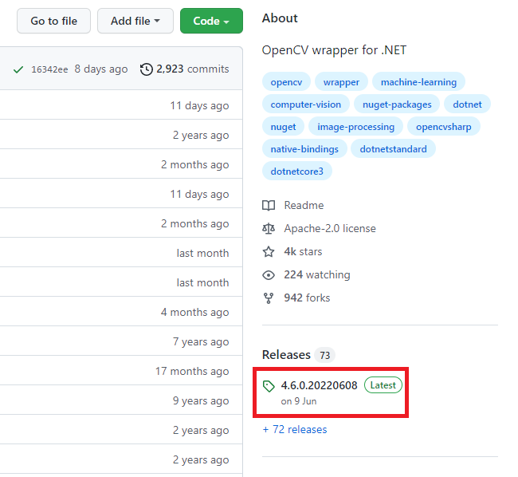  

**3.** 자신의 버전찾아 `.zip`파일 다운  

`Nuget`에서 설치한 버전과 같은 버전 `(이 프로젝트에서는 4.6.0.20220608 Tag)`을 클릭한다.  
아래의 Assets에서 `.zip`파일을 다운받도록 하자.  

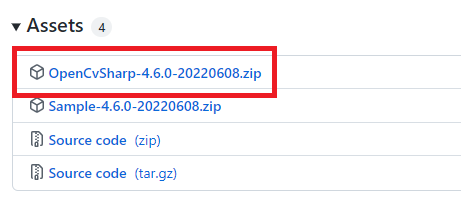  

**4.** 압축 해제 후, 본인의 프로젝트에 dll 넣기  

압축을 풀고난 뒤, **NativeLib/win/x64/** 경로에서 `OpenCvSharpExtern.dll`를 복사하자.  
그 후, `내 프로젝트`의 `bin, obj가 보이는 경로`에다 붙여넣자.  

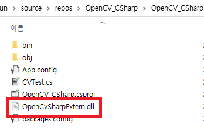  

**5.** `Visual Studio` 에서 `프로젝트 - 기존 항목 추가`  

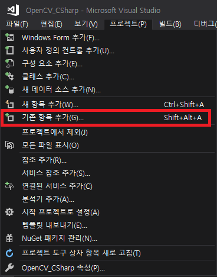  

**6.** 하단에 모든 파일 선택, 아까 붙여넣기한 파일 선택`(OpenCvSharpExtern.dll)` 추가   

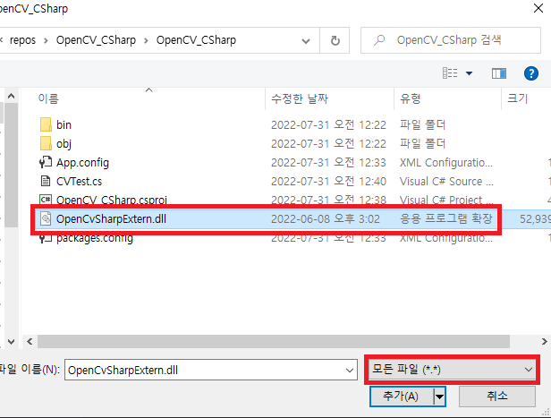  

**7.** 솔루션 탐색기 - 추가한 dll 파일 우클릭 - 속성 `출력 디렉터리에 복사 : 항상 복사` 설정  

<a href="https://kdjun97.github.io/assets/images/post_img/computer-vision/opencv-csharp-install/always_copy.png">
  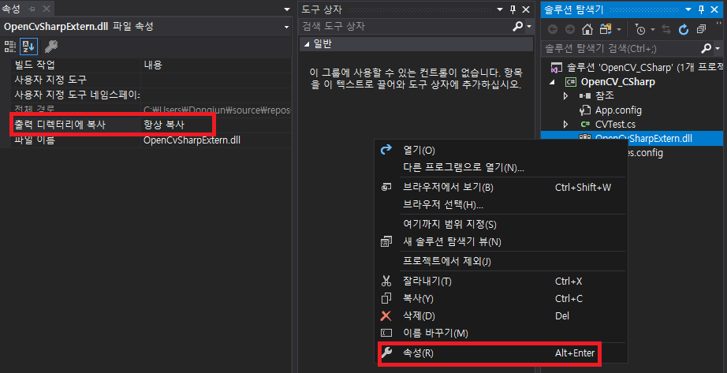
</a>

---  

## 🦉 솔루션 플랫폼 x64 설정  

x64 환경에 맞춰서 빌드 환경을 바꿔주기    

**1.** `Any CPU` - `구성 관리자` 클릭  

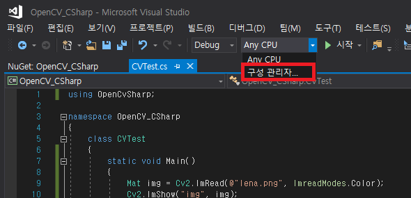  

**2.** `플랫폼` - `새로 만들기` 클릭  

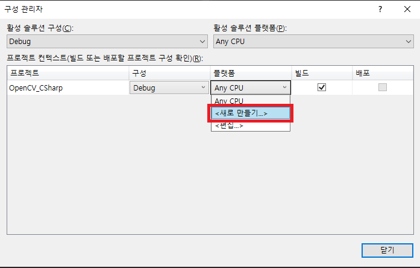  

**3.** `x64` 만들기  

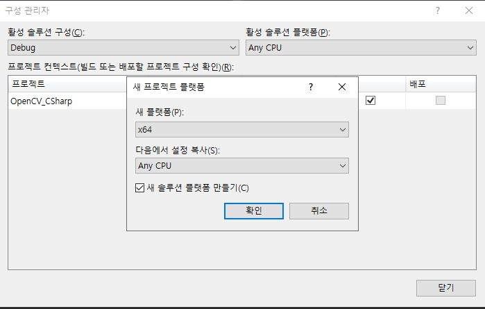  

**4.** x64 적용된 모습  

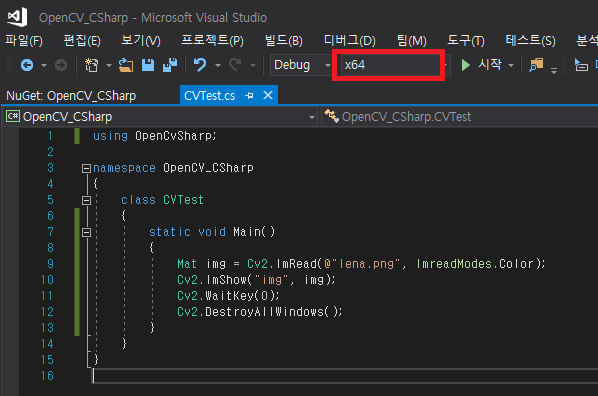  

**5.** 이제 소스 코드를 실행시켜보자.  
기존 에러는 해결되었지만, 새로운 종류의 에러가 뜬다.  
이 에러는 대부분 이미지 경로의 문제라고 한다.  
코드에서 잡던, file path로 잡던 경로 문제를 잡아보자.  

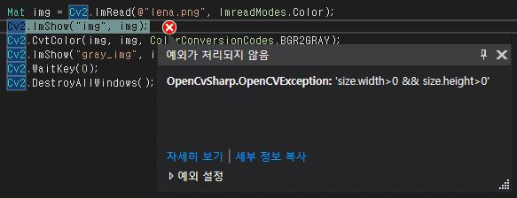  

**6.** `본인프로젝트/bin` 경로에 보면 x64 폴더가 생성되어 있다.  

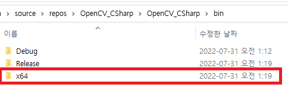  

**7.** `image path`를 `x64/Debug/lena.png`로 적용시키자.  
(절대 경로를 넣어줘도 해결됨)  
그리고 다시 실행.  

**8.** `Lena` 누나가 잘 나오는 것을 볼 수 있다.  

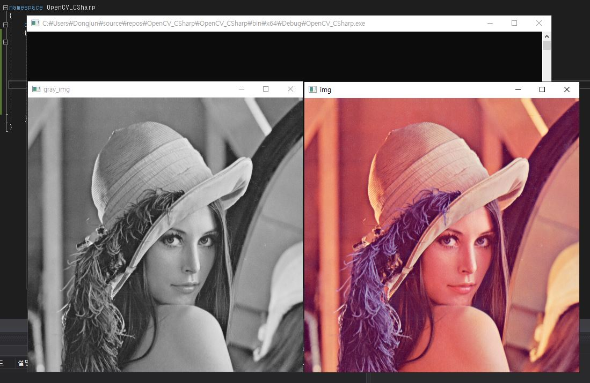  

이것으로 C#과 Visual Studio 2017 환경에서 `OpenCvSharp4`를 설치 및 간단한 예제를 진행해보았다.  