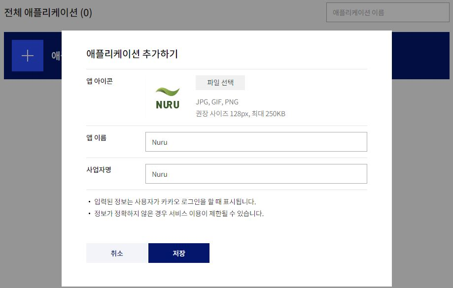
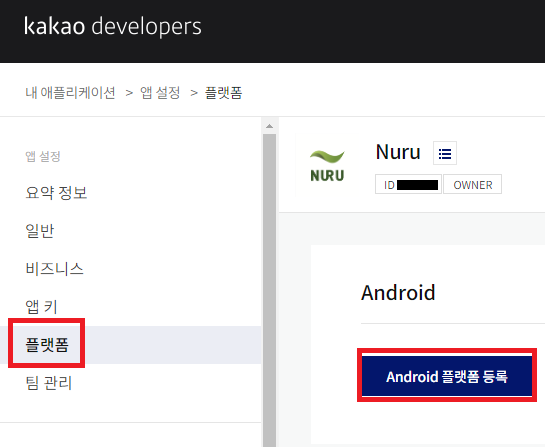
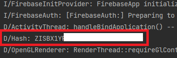
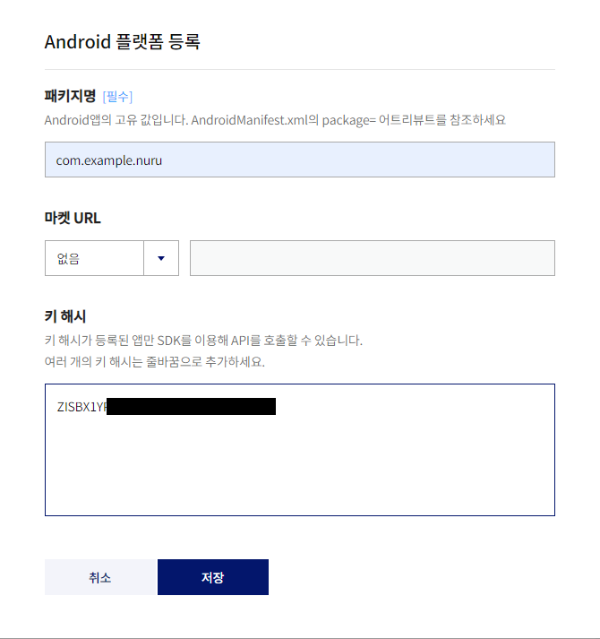
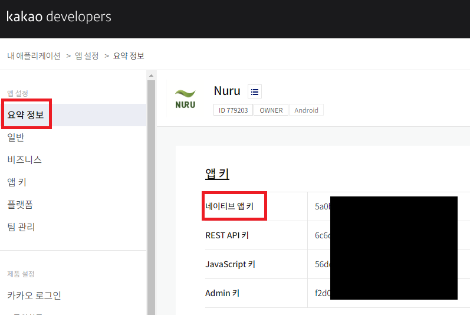
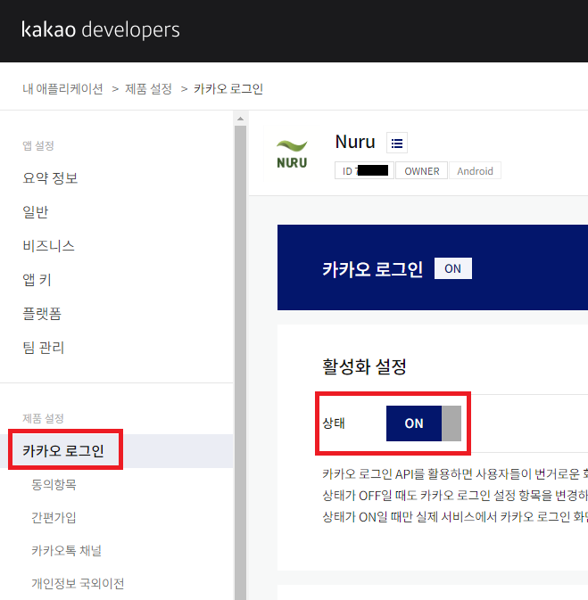
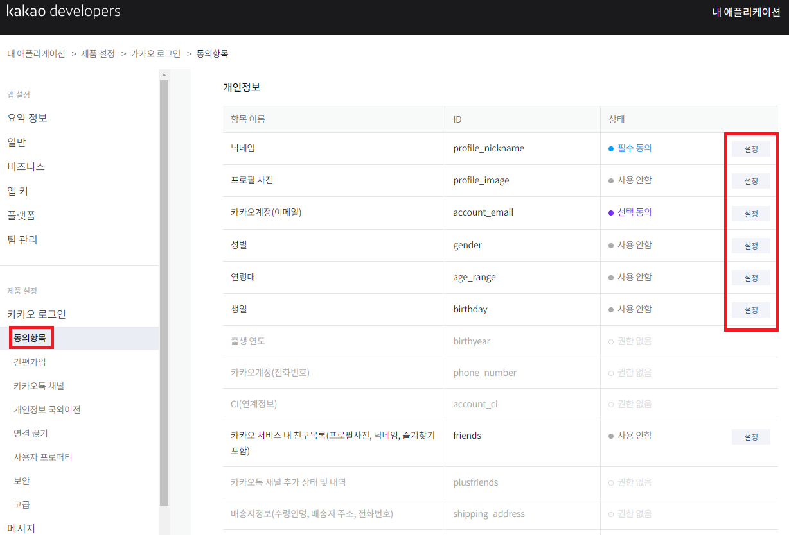
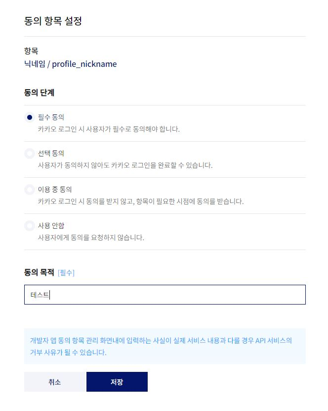

# 🍫 카카오 로그인 연동

`Kakao Developers`에선 `Kakao Login API`를 지원해주고있다.  
이를 이용하여 API 사용을 통해 쉽게 카카오 로그인을 구현할 수 있다.  
나는 API v2를 적용하여 로그인 연동을 해 볼 것이다.  

**Android SDK를 사용하기 위한 최소 요구 사양**  
- Android Studio 3.6.1 이상  
- API 21: Android 5.0(Lollipop) 이상  

진행 순서는  
**1.** 인터넷 권한 설정(AndroidManifest.xml)  
**2.** `gradle` 설정  
**3.** `Kakao Developers`에 앱 추가  
**4.** `네이티브 앱 키` 초기화  
**5.** `로그인 설정 활성화`  
**6.** 버튼 생성  
**7.** 로그인 코드  
**8.** 로그아웃 코드  
**9.** 회원 탈퇴 코드  

아래 카카오 개발 공식 문서를 참고하였다.  
본 포스팅 내용은 카카오 로그인에 관한 것이므로, 더욱 자세한 정보는 아래 공식 문서를 참고하자.  

> [Kakao Developers](https://developers.kakao.com/docs/latest/ko/kakaologin/android)  

---

# 🌐 1.인터넷 권한 설정

카카오 로그인 API를 이용하기 위한 인터넷 권한 설정  

`AndroidManifest.xml`  

```xml
<manifest xmlns:android="http://schemas.android.com/apk/res/android"
	xmlns:tools="http://schemas.android.com/tools"
	package="com.example.nuru">

	<!-- 인터넷 사용 권한 설정-->
    <uses-permission android:name="android.permission.INTERNET" />
</manifest>
```

---  

# 📦 2.gradle 설정 

`build.gradle(project)`  

**Kakao SDK Repository** 설정  

```gradle
repositories {
	maven { url 'https://devrepo.kakao.com/nexus/content/groups/public/' }
}
```

`build.gradle(module)`  

```gradle
// 카카오 로그인 모듈
implementation "com.kakao.sdk:v2-user:2.0.1"
implementation group: 'com.kakao.sdk', name: 'usermgmt', version: '1.27.0'
```  

---  

# 🍫 3.카카오에 앱 추가

`kakao developers console 로그인`  

아래 링크에서 자신의 카카오 계정(개발할 계정)으로 로그인을 한다.  

> [kakao console](https://developers.kakao.com/console/app)  

회원가입 창이 뜨면 회원가입, 아니라면 바로 애플리케이션 추가하기  

  

`Android 플랫폼 등록`  

자신이 추가한 애플리케이션에 들어간다.  
Side Menu에서 **플랫폼 - Android 플랫폼 등록** 클릭  

  

**패키지명** : `AndroidManifest.xml` 의 package attribute에 `com.example.xxx`라고 된 부분  
**마켓 URL** : 없어서 비웠음  
**키 해시** : 아래의 과정  

`키 해시 얻는 과정`  

Kotlin code에서 따와야한다. 코드는 아래와 같다.   

```kotlin
import androidx.appcompat.app.AppCompatActivity
import android.os.Bundle
import android.util.Log
import com.kakao.sdk.common.util.Utility

class MainActivity : AppCompatActivity() {
    override fun onCreate(savedInstanceState: Bundle?) {
        super.onCreate(savedInstanceState)
        setContentView(R.layout.activity_main)
        
        val keyHash = Utility.getKeyHash(this)
        Log.d("Hash", keyHash)
    }
}
```  

`Log`  

  

복사하여 위 form에 붙여넣기 한다.  

  

---

# 🔑 4.네이티브 앱 키

Kakao SDK 사용을 위해선 네이티브 앱 키 초기화가 필요하다.  
우리는 앱이 시작할 때, 네이티브 앱 키를 초기화하는 과정을 적용시킬 것이다.  

`네이티브 앱 키 확인`  

  

아래 코드에서 `KakaoSdk.init()`안에 들어갈 string은 위 그림 참고  

`kotlin 코드`  

```kotlin
import android.app.Application
import com.kakao.sdk.common.KakaoSdk

class GlobalApplication : Application() {
    override fun onCreate() {
        super.onCreate()
        KakaoSdk.init(this, getString(R.string.kakao_native_key))
    }
}
```  

이제 위 코드를 앱이 시작할 때, 다른 컴포넌트 보다 먼저 실행되도록 설정해야 한다.  
또한, 카카오 로그인 API 호출시, 다른 페이지(카카오 로그인 페이지)로 넘어가기 때문에, activity를 추가해야 한다.  

`AndroidManifest.xml`  

```xml
<manifest xmlns:android="http://schemas.android.com/apk/res/android"
    xmlns:tools="http://schemas.android.com/tools"
    package="com.example.nuru">

	<application
        android:name=".utility.GlobalApplication">
		...
		<activity
            android:name="com.kakao.sdk.auth.AuthCodeHandlerActivity"
            android:exported="true">
            <intent-filter>
                <action android:name="android.intent.action.VIEW" />
                <category android:name="android.intent.category.DEFAULT" />
                <category android:name="android.intent.category.BROWSABLE" />
                <data
                    android:host="oauth"
                    android:scheme="@string/kakao_key" />
            </intent-filter>
        </activity>
		...
	</application>
	...
</manifest>
```

위의 `@string/kakao_key` 형식은 `kakao + 네이티브 앱 키`이다.  
자신의 네이티브 앱 키가 asbc1234라면 위의 string에 `kakaoasbc1234`가 들어가면 되겠다.  

---

# 🔧 5.로그인 설정   

카카오 로그인 설정 활성화.  

  

동의항목 - 원하는 것 체크  

<a href="https://kdjun97.github.io/assets/images/post_img/kotlin/kotlin-kakao-login/agree.png">
  
</a>

  

🔥 SideMenu - 카카오 로그인 - 아래에서 Redirect URI를 등록할 수 있다.  
필수적으로 설정을 해야한다고 하는데, 나는 설정하지 않아도 잘 되었다.  
따라서, 이 부분은 건드리지 말고 9번까지 진행하다가, 문제가 생겼을 경우,  
Redirect URI등록을 해볼 것을 추천한다.  
참고로 아무 URI나 등록해도 상관없다고 한다.  
{: .notice--danger}   

---

# 🎲 6.버튼 생성

> [카카오 디자인 가이드](https://developers.kakao.com/docs/latest/ko/reference/design-guide)  

위 공식 문서에서 제공해주는 버튼 이미지를 활용하였다.  

ImageButton으로 구현하였고, onClick에 대한 처리까진 빠르게 넘어가도록 하겠다.  

---

# 🎰 7.로그인 코드

`MainActivity.kt`, `LoginFragment.kt`를 생성하자.  
불필요한 부분들은 빠르게 넘기고 최소한의 코드만 보도록 하자.  

나는 앱 시작시, MainActivity에서 유저 로그인 정보를 확인하고, 로그인이 되었으면 다른 Activity로 넘어간다.  
만약 로그인이 안되어 있다면, LoginActivity로 넘어가도록 설계하였다.  
LoginActivity에서는 Nav Graph에 따라 fragment를 바꿔준다.   
LoginFragment에 버튼이 있다.  

`MainActivity.kt`  

로그인 확인 코드이다.  
카카오 로그인 부분만 가져왔다.  

```kotlin
// 카카오 로그인 정보 확인
UserApiClient.instance.accessTokenInfo { tokenInfo, error ->
	if (error != null) {
		val intent = Intent(this, LoginActivity::class.java)
		startActivity(intent)
		finish()
	}
	else if (tokenInfo != null) {
		val intent = Intent(this@MainActivity, MyPageActivity::class.java)
			startActivity(intent)
			finish()		
		}
	}
}
```

`LoginFragment.kt`  

```kotlin
lateinit var kakaoCallback: (OAuthToken?, Throwable?) -> Unit

fun btnKakaoLogin(view: View) {
	// 카카오톡이 설치되어 있으면 카카오톡으로 로그인, 아니면 카카오계정으로 로그인
	if(LoginClient.instance.isKakaoTalkLoginAvailable(loginActivity)){
		LoginClient.instance.loginWithKakaoTalk(loginActivity, callback = kakaoCallback)
	}else{
		LoginClient.instance.loginWithKakaoAccount(loginActivity, callback = kakaoCallback)
	}
}

fun setKakaoCallback() {
	kakaoCallback = { token, error ->
		if (error != null) {
			when {
				error.toString() == AuthErrorCause.AccessDenied.toString() -> {
					Log.d("[카카오로그인]","접근이 거부 됨(동의 취소)")
				}
				error.toString() == AuthErrorCause.InvalidClient.toString() -> {
					Log.d("[카카오로그인]","유효하지 않은 앱")
				}
				error.toString() == AuthErrorCause.InvalidGrant.toString() -> {
					Log.d("[카카오로그인]","인증 수단이 유효하지 않아 인증할 수 없는 상태")
				}
				error.toString() == AuthErrorCause.InvalidRequest.toString() -> {
					Log.d("[카카오로그인]","요청 파라미터 오류")
				}
				error.toString() == AuthErrorCause.InvalidScope.toString() -> {
					Log.d("[카카오로그인]","유효하지 않은 scope ID")
				}
				error.toString() == AuthErrorCause.Misconfigured.toString() -> {
					Log.d("[카카오로그인]","설정이 올바르지 않음(android key hash)")
				}
				error.toString() == AuthErrorCause.ServerError.toString() -> {
					Log.d("[카카오로그인]","서버 내부 에러")
				}
				error.toString() == AuthErrorCause.Unauthorized.toString() -> {
					Log.d("[카카오로그인]","앱이 요청 권한이 없음")
				}
				else -> { // Unknown
					Log.d("[카카오로그인]","기타 에러")
				}
			}
		}
		else if (token != null) {
			Log.d("[카카오로그인]","로그인에 성공하였습니다.\n${token.accessToken}")
			UserApiClient.instance.accessTokenInfo { tokenInfo, error ->
				UserApiClient.instance.me { user, error ->
 	            	nickname.text = "닉네임: ${user?.kakaoAccount?.profile?.nickname}"
        		}
			}
		}
		else {
			Log.d("카카오로그인", "토큰==null error==null")
		}
	}
}
```

# ⚙️ 8.로그아웃  

```kotlin
UserApiClient.instance.logout { error ->
	if (error != null) {
		Log.d("카카오","카카오 로그아웃 실패")
	}else {
		Log.d("카카오","카카오 로그아웃 성공!")
	}
}
```

---

# ❌ 9.회원 탈퇴

```kotlin
UserApiClient.instance.unlink { error ->
	if (error != null) {
		Log.d("카카오로그인","회원 탈퇴 실패")
	}else {
		Log.d("카카오로그인","회원 탈퇴 성공")
	}
}
```