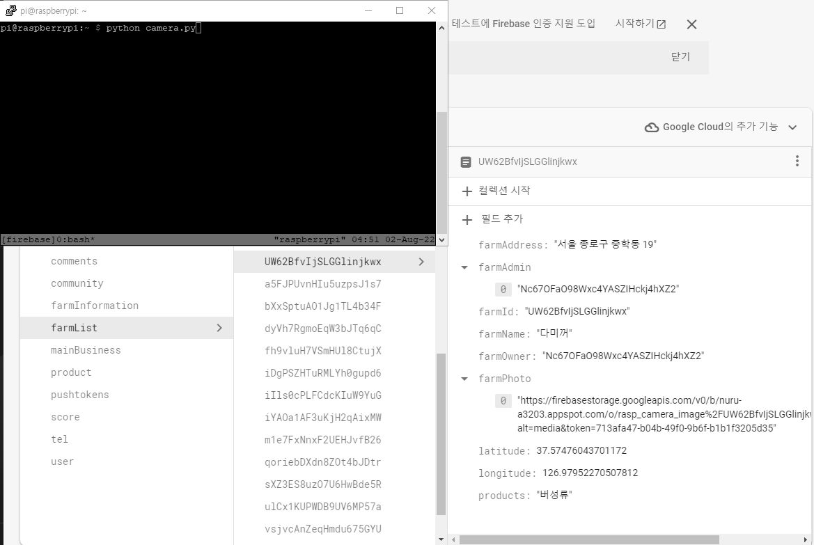
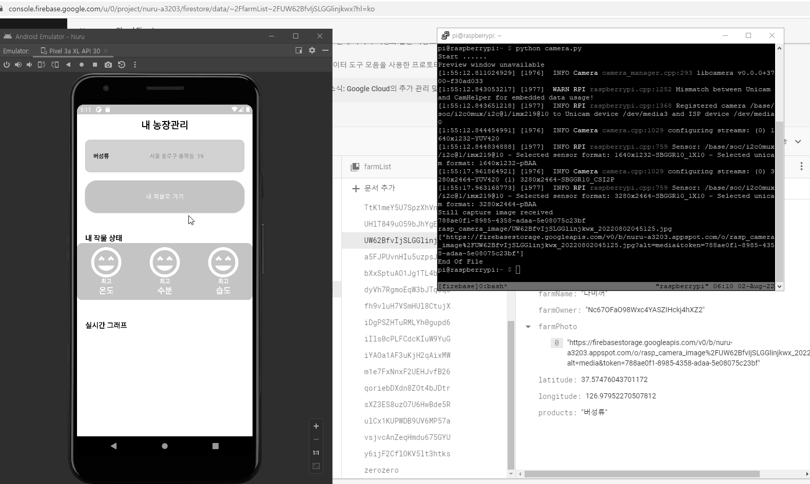
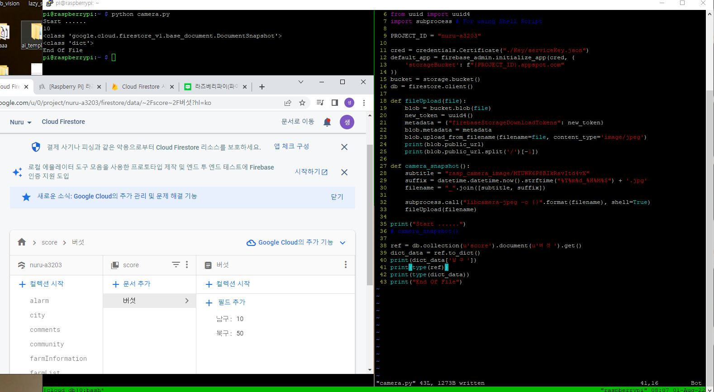
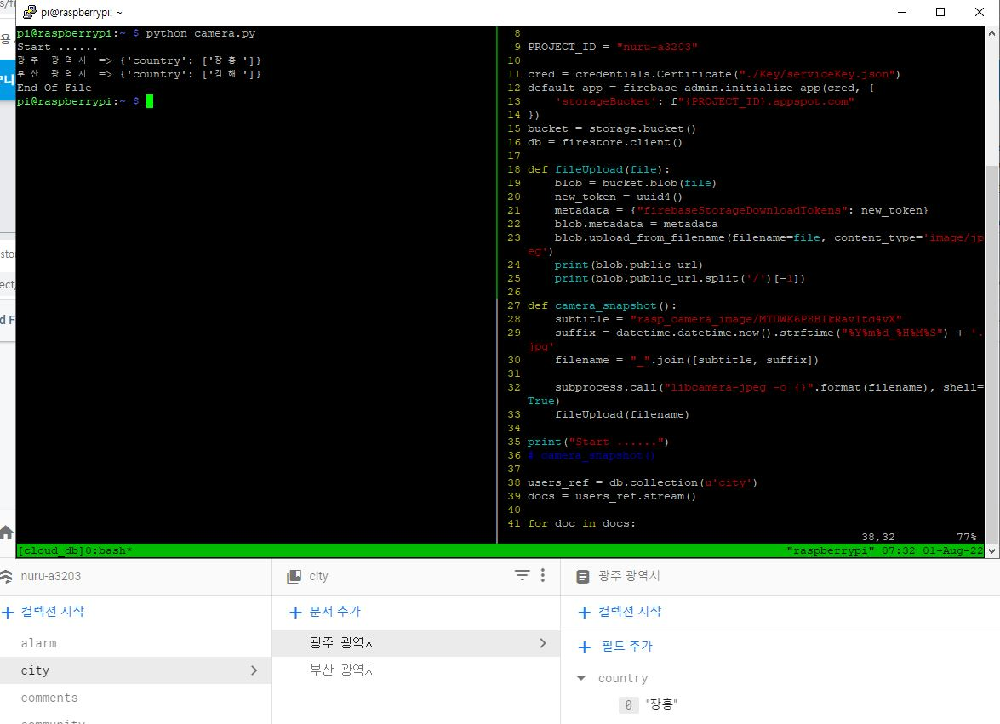
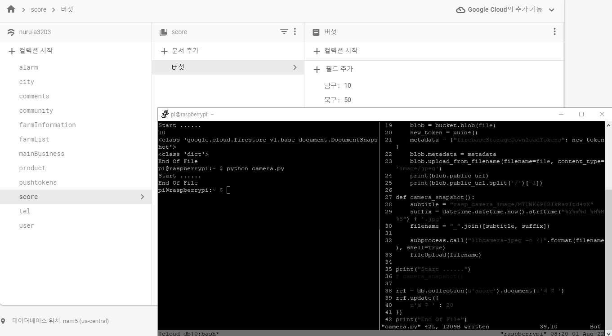
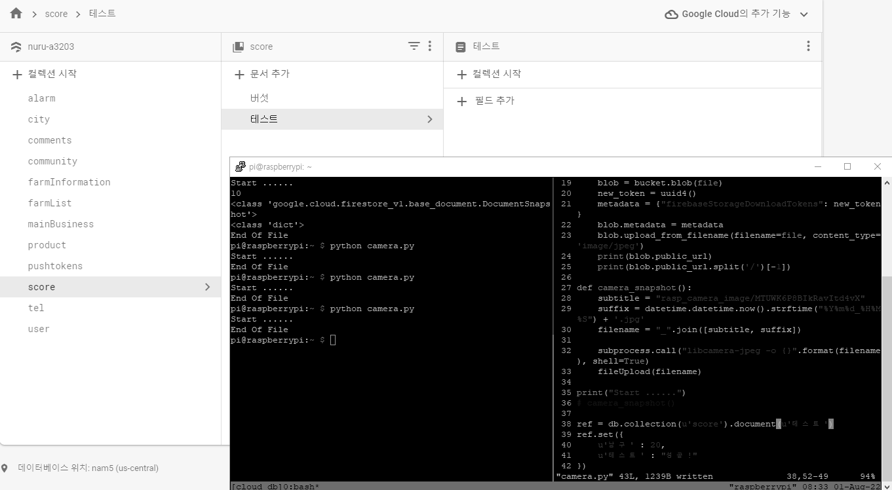

## 🔧 개발환경

Python 3.9.2  
Firebase  
Raspberry Pi 4 8GB RAM  
카메라 모듈 V2, 8MP (RPI 8MP CAMERA BOARD)  
Rasberry Pi OS (64-bit) (Debian Bullseye)  

---  

## 🔥 Cloud Firestore 이용 

google firebase에서 제공하는 공식문서 참고하였음.  

> [Firebase 공식문서](https://firebase.google.com/docs/firestore/quickstart?hl=ko#python)  

이전 포스팅에서 라즈베리파이4 에서 `카메라 모듈을 가지고 사진을 찍어봤고`, 그것을 `Firebase Storage`에 올려봤다.  
이번 포스팅에서는 `Cloud Firestore`에 찍었던 사진의 `URI`를 올려볼 것이다.  
아래 부분(2부?)에서는 `Cloud Firestore CRUD`기능에 대해 다룰 것이다.  
`CRUD` 기능에 대해서만 궁금하다면 아래쪽으로 가자.  

`전제 조건`  

**1.** 아래 링크 글에 대한 수행을 다 했다고 가정.  

> [이전 글 참고 : 라즈베리파이4 카메라 + firebase storage 업로드](https://kdjun97.github.io/iot/raspberry-pi-firebase-storage/)  

**2.** 기존 firebase Cloud Firestore 프로젝트가 있다고 가정.  
**3.** 이전 코드 `(camera image upload)`를 이어서 작성.  

`Cloud Firestore`접근을 위해 필요한 라이브러리를 import한다.  

```python
from firebase_admin import firestore
```

이전 포스팅에서 이미지를 올린 (Storage path)와 실제 우리가 접근할 수 있는 path는 print해보면 조금 다르다.  
`blob.public_url`로 들어간다면 `access denied`문구가 뜰 것이다. (토큰이 필요)  
따라서, 지금 이 예제에서는 코드 내에서 token 값을 포함하여 URI를 살짜쿵 만져준 후, Cloud에 올릴 것이다.  

Firebase Storage에서 이미지 파일을 열어보면, 변하는 부분이 있고, 변하지 않는 부분이 존재한다.  
변하는 부분은 `Dir명, File명, token값`이었다.  
따라서 그 외의 부분들은 고정을 하고, 위의 3개 부분들에 대해서 변수로 처리를 하면 되겠다고 생각했다.  
더 자세한 부분은 코드에서 주석으로 설명을 하겠다.  

`전체 코드 작성`  

```python
import datetime
import firebase_admin
from firebase_admin import credentials
from firebase_admin import storage
from firebase_admin import firestore # For using Cloud Firestore
from uuid import uuid4 # For token
import subprocess # For using Shell Script

PROJECT_ID = "nuru-a3203" # Owner Project ID

cred = credentials.Certificate("./Key/serviceKey.json") # Service Key Path

default_app = firebase_admin.initialize_app(cred, {
    'storageBucket': f"{PROJECT_ID}.appspot.com"
})
bucket = storage.bucket()
db = firestore.client() # For DB Access
global path, uid, new_token # For URI

def fileUpload(file):
    global path, uid, new_token
    blob = bucket.blob(file)
    new_token = uuid4()
    metadata = {"firebaseStorageDownloadTokens": new_token}
    blob.metadata = metadata
    blob.upload_from_filename(filename=file, content_type='image/jpeg')
    path = (file.split('/')[1]).split('_')[1] # 파일을 만들 때, parsing을 고려하여 만들었기 때문에 정해진 형식 내에서 split

def camera_snapshot():
    subtitle = f"rasp_camera_image/{uid}" # 직접 지정해준 Directory/UID
    suffix = datetime.datetime.now().strftime("%Y%m%d%H%M%S") + '.jpg' # 현재시간
    filename = "_".join([subtitle, suffix]) # 둘을 '_' 기준으로 합침
    subprocess.call("libcamera-jpeg -o {}".format(filename), shell=True) # Shell Script 실행 (libcamera 이용)
    fileUpload(filename)

print("Start ......")
uid = "UW62BfvIjSLGGlinjkwx" # 현재는 uid를 명시해줌.
camera_snapshot()
ref = db.collection(u'farmList').document(f'{uid}')
storage_path = f"https://firebasestorage.googleapis.com/v0/b/{PROJECT_ID}.appspot.com/o/rasp_camera_image%2F{uid}_{path}?alt=media&token={new_token}"
data_list = [] # farmList field가 ArrayList이기 때문
data_list.append(storage_path)
ref.update({
  'farmPhoto': data_list
})
print("End Of File")
```

아래는 python 코드로 Cloud Firestore에 Uri를 올리는 영상이다.  

<a href="https://kdjun97.github.io/assets/images/post_img/iot/raspberry-pi-cloud-firestore/camera.gif">
  
</a>  

kotlin 앱에서 Glide를 통해 Uri이미지를 불러오는 아래 영상을 참고하자.  

<a href="https://kdjun97.github.io/assets/images/post_img/iot/raspberry-pi-cloud-firestore/result.gif">
  
</a>  

이제 이와 같은 기능을 PuTTY에서 python 코드를 직접 실행하는 것이 아닌, 앱에서 버튼을 조작하여 처리하도록 만든다면, 원거리에서도 라즈베리파이 카메라 모듈을 사용할 수 있게 될 것이다.  
또한, uid를 하드코딩으로 넣었지만, 쿼리를 통해 직접 가져오는 로직을 가져와야 할 것이다(앱에서 버튼 이벤트가 호출되었을 때)  
이에 관한 로직을 짤 것이고, 파이썬 코드를 라즈베리파이에서 background로 돌릴 예정이다.  

> 다음 내용은 아래 글1, 글2 순서로 보면 된다.  
> [다음 글1 : 라즈베리파이 Real-Time Data Listener](https://kdjun97.github.io/iot/raspberry-pi-real-time-cloud/)  
> [다음 글2 : 라즈베리파이 원격 제어 (코틀린 사용)](https://kdjun97.github.io/iot/raspberry-pi-with-kotlin/)  

자 이번 포스팅은 여기서까지만 하고, 아래에서는 `Cloud Firestore`에서의 DB CRUD 기능을 알아보도록 하자.  

---  

## 💡 Data Read

특정 document의 값을 읽어보자.  

```python
ref = db.collection(u'score').document(u'버섯').get() # document 정보 get
dict_data = ref.to_dict() # dict type으로 바꿔줌
print(dict_data['남구']) # 원하는 하나의 field
```

`전체 코드`  

```python
import firebase_admin
from firebase_admin import credentials
from firebase_admin import firestore # For Cloud Firestore
from uuid import uuid4

PROJECT_ID = "nuru-a3203" # Owner Project ID

cred = credentials.Certificate("./Key/serviceKey.json") # Service Key Path

default_app = firebase_admin.initialize_app(cred, {
    'storageBucket': f"{PROJECT_ID}.appspot.com"
})
bucket = storage.bucket()
db = firestore.client()

print("Start ......")
ref = db.collection(u'score').document(u'버섯').get() # document 정보 get
dict_data = ref.to_dict() # dict type으로 바꿔줌
print(dict_data['남구']) # 원하는 하나의 field
print(type(ref))
print(type(dict_data))
print("End Of File")
```

<a href="https://kdjun97.github.io/assets/images/post_img/iot/raspberry-pi-cloud-firestore/read.JPG">
  
</a>  

`collection 하나를 잡아서 전체를 보여주는 코드`  

```python
users_ref = db.collection(u'city')
docs = users_ref.stream()

for doc in docs:
	print(f'{doc.id} => {doc.to_dict()})
```

<a href="https://kdjun97.github.io/assets/images/post_img/iot/raspberry-pi-cloud-firestore/result.JPG">
  
</a>  

---  

## 🔧 Data Update

이제부턴 간략하게 작성하겠다.  

```python
ref = db.collection(u'score').document(u'버섯')
ref.update({
	u'남구':20
})
```

<a href="https://kdjun97.github.io/assets/images/post_img/iot/raspberry-pi-cloud-firestore/update.gif">
  
</a>  

---  

## ✔️ Data Create

```python
ref = db.collection(u'score').document(u'테스트')
ref.set({
    u'남구':20,
    u'테스트':"성공!"
})
```

<a href="https://kdjun97.github.io/assets/images/post_img/iot/raspberry-pi-cloud-firestore/create.gif">
  
</a>  

---  

## ❌ Data Delete

```python
ref = db.collection(u'score').document(u'테스트')
ref.delete()
```

<a href="https://kdjun97.github.io/assets/images/post_img/iot/raspberry-pi-cloud-firestore/delete.gif">
  
</a>  
