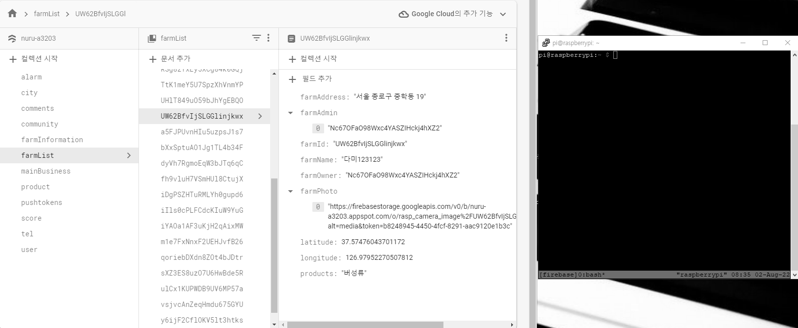

## 🔧 개발환경

Python 3.9.2  
Firebase  
Raspberry Pi 4 8GB RAM  
Rasberry Pi OS (64-bit) (Debian Bullseye)  

---  

## 👂 Data Listener

> [이전글 참고 : 라즈베리파이4, Cloud Firestore 사용하기](https://kdjun97.github.io/iot/raspberry-pi-cloud-firestore/)  

실시간으로 바뀌는 데이터에 반응하는 방법은 많을 것이다.  
이번 프로젝트에서 내가 채택한 방법은 `Cloud Firestore`에 `Listener`를 다는것이다.  

추후에 앱이 커지면 `listener`를 다는 것은 부담이 될 것임은 염두해 두자.  

python에서 firebase를 사용할 때, **collection과 document**에 `on_snapshot`을 달 수 있다.  
이것이 <u>listener 역할</u>을 해 줄 것이다.  

이미 진행중인 프로젝트가 있다고 가정하고 글을 쓰겠다.  

```python
import firebase_admin
from firebase_admin import credentials
from firebase_admin import firestore # For using Cloud Firestore
import time # For delay

cred = credentials.Certificate("./Key/serviceKey.json") # Service Key Path
default_app = firebase_admin.initialize_app(cred)
db = firestore.client() # For DB Access

def handler(keys, changes, read_time): # listener
	key = keys[0].get('farmName') # write field path 
	data = f'{read_time} / [{key}]' # for check
	print(data) # for check

print("Start ......")
ref = db.collection(u'farmList').document(f'{uid}').on_snapshot(handler) # snapshot 찰칵!

while True: # Loop
	time.sleep(3) # every 3 seconds
	print('processing...')

print("End Of File")
```

위 코드 실행 영상이다.  

<a href="https://kdjun97.github.io/assets/images/post_img/iot/raspberry-pi-real-time-cloud/result.gif">
  
</a>  

어떤 doc를 snapshot 찍는가와 어떤 로직을 짜는가에 따라 이 코드를 유용하게 응용하면 원거리(100km 멀리서도) 라즈베리파이 제어가 가능할 것이다.  

---  

### 🔔 추후 작업

kotlin 앱 - `button onClick` - Cloud DB 업데이트 (field명은 대충 `isClick: Boolean`)  
그 값의 변화에 따라 라즈베리파이에서 사진을 찍기 - 다시 isClick 업데이트  
라즈베리파이 환경에서 background로 python 코드 계속 실행.  
이론상 잘 작동될 것 같다.  

> [다음 글 : 라즈베리파이 원격 제어 (코틀린 사용)](https://kdjun97.github.io/iot/raspberry-pi-with-kotlin/)  