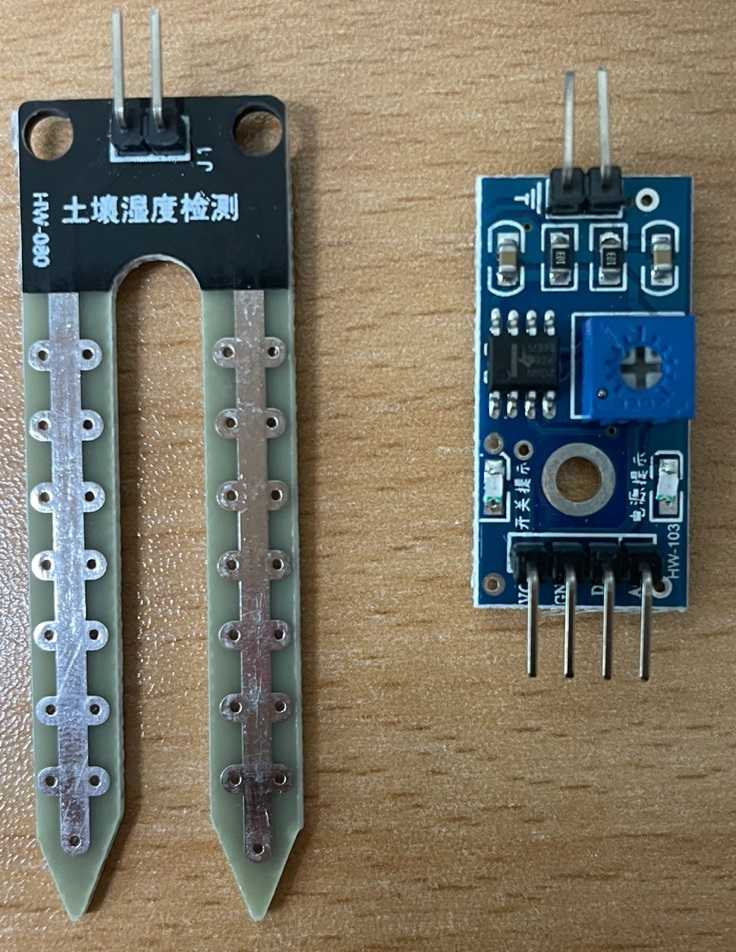
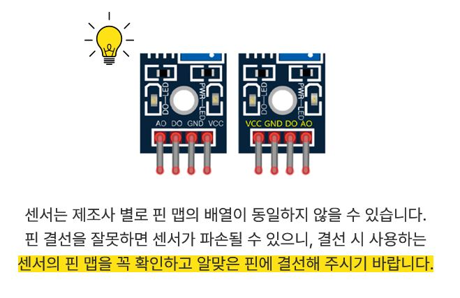
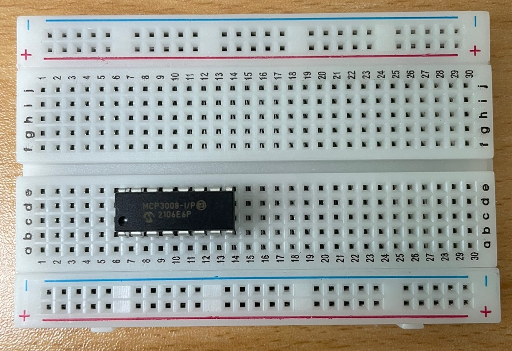
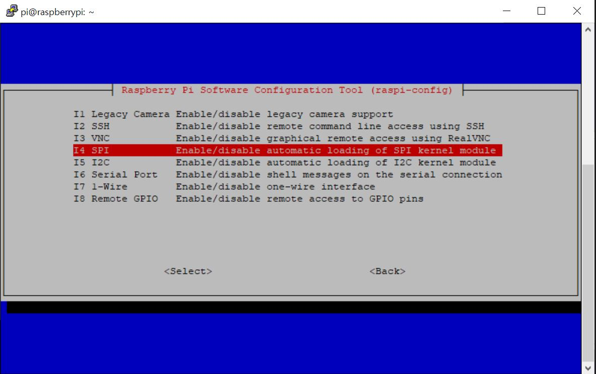
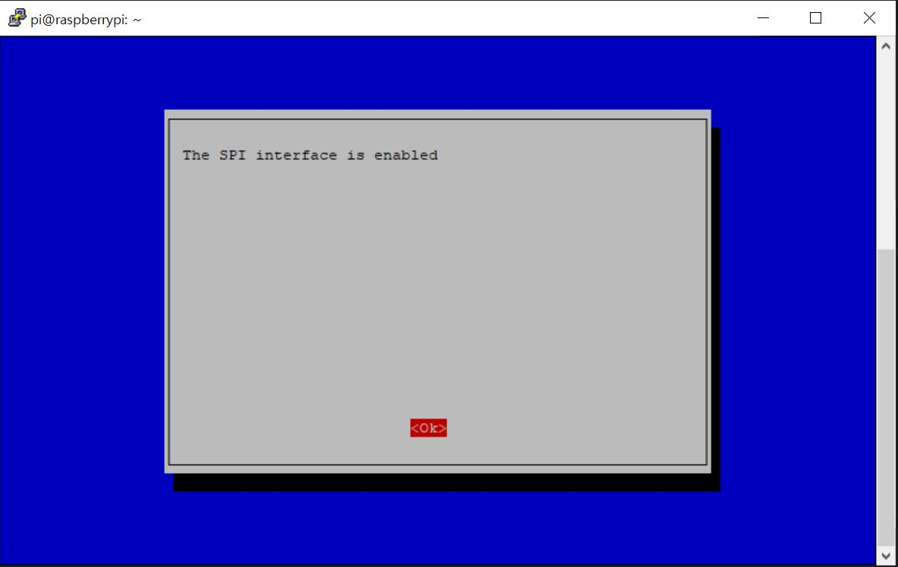
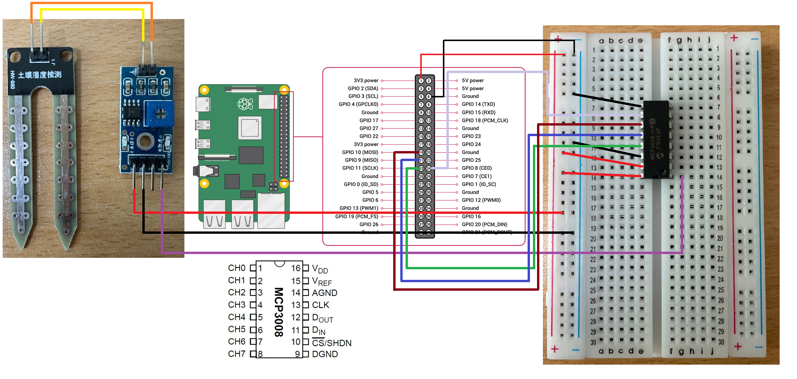
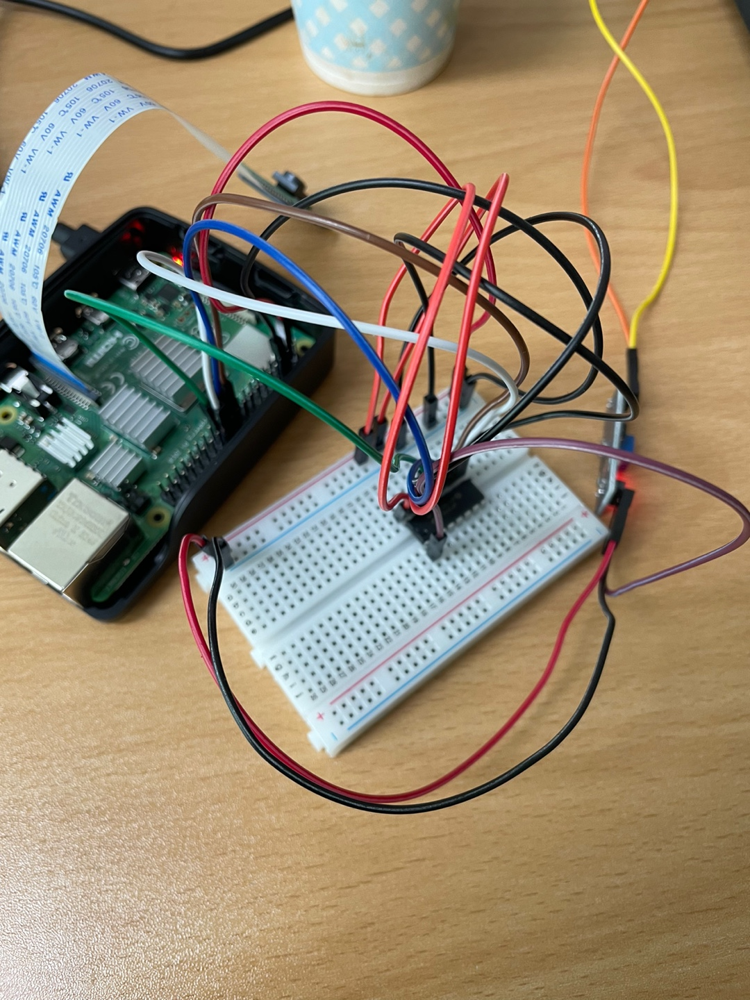
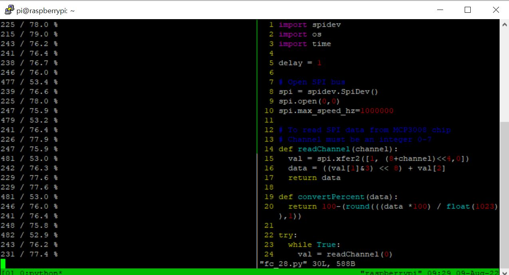
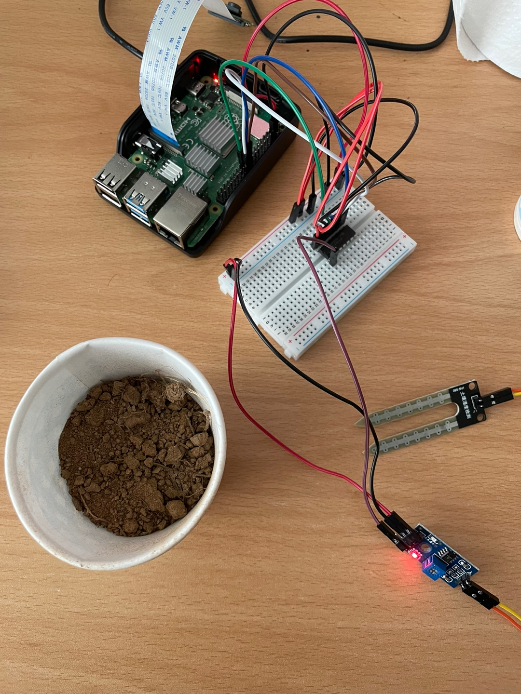
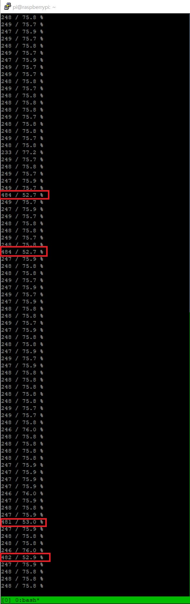

## 🔧 개발환경

Python 3.9.2  
Raspberry Pi 4 8GB RAM  
Rasberry Pi OS (64-bit) (Debian Bullseye)  
FC-28 (Soil Moisture Sensor)  
MCP3008 I/P for ADC  
BreadBoard (400 tie-point)  

---  

## 🚿 FC-28(토양 수분 감지 센서)

💡 광고아님.  
[구매처 : 에듀이노](https://eduino.kr/product/detail.html?product_no=84&cate_no=27&display_group=1)  
{: .notice--info}   

**1.** 토양 수분 감지 가능  
**2.** 저렴한 가격 (5000원 미만으로 구매함)  
**3.** 토양 내 수분함량에 따른 저항의 변화를 측정하는 센서  
**4.** 토양 내 수분함량이 적어짐 -> 저항값이 커짐 -> 전류가 잘 흐르지 않음  
**5.** 토양 내 수분함량이 많아짐 -> 저항값이 작아짐 -> 전류가 잘 흐름  

  
왼쪽이 센서, 오른쪽이 센서값 변환보드.  
센서값 변환보드 아래 4핀(왼쪽부터 VCC, GND, DO, AO)  

  
제조사에 따라 핀 배열이 다른 것 같다.  
잘 보고 맵핑하자. (출처 : 위 구매처)  

`FC-28 스펙`  

- 용도 : 토양의 수분을 감지하여 디지털 또는 아날로그 센서값을 출력하는 모듈  
- 동작 전압 : 3.3V ~ 5V  
- 동작 전류 : 30mA
- 센서 DO (TTL) : 0 or 1 (5V HIGH, 수분 부족시)
- 출력센서 AO (아날로그) : 0 or 1 (5V HIGH, 수분 부족시)
- 출력 : 0.1 ~ 0.3V / 5V
- 핀 구성 : 4핀 (VCC / GND / DO / AO)
- 크기 
  - 센서 : 19x5x64mm
  - 센서값 변환보드 : 15x7x40mm
  - 총 길이 : 290mm
- 특징
  - 작물 자동급수장치 등과 같은 식물관리 장치를 만드는 데 이용
  - 가격 및 동작 방법이 간단해 교육용으로 적합함  

---

## 🧩 MCP3008  

💡 Tip!  
아두이노는 MCP3008 없이, DO로 바로 값을 읽어들일 수 있다.  
더욱 쉽게 토양 수분 함량을 측정할 수 있음.  
{: .notice--info}   

라즈베리파이는 아두이노와 다르게 자체적으로 아날로그 센서값을 읽어오지 못한다.   
`ADC(Analog-Digital Converter)`를 가지지 않기 때문. `DAC(Digital-Analog Converter)`도 없다.  

`MCP3008`은 아날로그 값을 디지털 값으로 convert하여 라즈베리파이에 넣어주는 역할을 도와준다.  
따라서, FC-28에서 오는 아날로그 전압을 받기 위해서는 `ADC 기능을 가진 MCP3008 IC`가 필요하다.  

  

그리고 센서값을 받기 위해서는 라즈베리파이에서 `SPI 통신 설정`을 `Enalbe`해주어야 한다.  

`$ sudo raspi-config` 명령어 입력(설정 화면) - `Interface Option` - `SPI Enable`  

  
  

---

## 📎 PinMapping

**R-Pi4 > MCP3008**  

Pin 1 (3.3V) > VDD  
Pin 1 (3.3V) > VREF  
Pin 6 (GND) > AGND  
Pin 23 (SCLK) > CLK  
Pin 21 (MISO) > D_OUT  
Pin 19 (MOSI) > D_IN  
Pin 24 (CE0) > CS/SHDN  
Pin 6 (GND) > DGND  

**R-Pi4 > FC-28**  

Pin 1 (3.3V) > VCC  
Pin 6 (GND) > GND  

**FC-28 > MCP3008**  

AO > CH0  

아래 사진을 참고하자.  
그리고 BreadBoard(일명:빵판)에 MCP3008이 180도 회전한 상태로 꽂아져있으니 참고하길 바란다.  

<a href="https://kdjun97.github.io/assets/images/post_img/iot/raspberry-pi-soil-moisture1/pin_map.png">
  
</a>  

아래는 실제 내 라즈베리파이와 빵판에 적용한 사진이다.  

  

이렇게 하면 준비가 끝난다. (짧은 선이 없어서 매우 지저분해 보이는 부분은 양해 바란다.)  

---

## 🌼 Python Code

우리는 spidev라는 패키지를 사용할 것이다.  

최신 버전의 spidev를 설치해주자. 
`$ sudo pip3 install --upgrade spidev`  

```python
import spidev
import time

delay = 1 

# Open Spi Bus
# SPI 버스 0과 디바이스 0을 열고
# 최대 전송 속도를 1MHz로 설정
spi = spidev.SpiDev()
spi.open(0,0) # open(bus, device)
spi.max_speed_hz = 1000000 # set transfer speed

# To read SPI data from MCP3008 chip
# Channel must be 0~7 integer
def readChannel(channel): 
  val = spi.xfer2([1, (8+channel)<<4, 0])
  data = ((val[1]&3) << 8) + val[2]
  return data

# 0~1023 value가 들어옴. 1023이 수분함량 min값
def convertPercent(data):
  return 100.0-round(((data*100)/float(1023)),1)

try:
  while True:
    val = readChannel(0)
    if (val != 0) : # filtering for meaningless num
      print(val, "/", convertPercent(val),"%")
    time.sleep(delay)
except KeyboardInterrupt:
  spi.close()
  print("Keyboard Interrupt!!!!")
```

처음 `readChannel`로 value를 측정해보면, 0~1023의 값이 나오고, 수가 커질수록 토양의 수분 함량이 적다는 뜻이다.  
0이 계속 뜨는 이슈때문에 조건문을 달아주었다.  

이 코드를 실행했을 때의 결과는 아래와 같다.  

<a href="https://kdjun97.github.io/assets/images/post_img/iot/raspberry-pi-soil-moisture1/result.JPG">
  
</a>  

코드 실행 1분 후의 사진이다.  
기대했던 만큼의 퍼포먼스를 보여주지 않았다.  
센서, 핀 맵핑을 이상하게 하였다면, 아예 값이 나오지 않아야 하는데, 값이 나오기는 하나 만족스럽지 않다.   
이것은 센서나 선 연결 문제이지 않을까?  
혹은 너무 싼 센서나 보드를 사용하여 그런 것인지? 선이 너무 길어서 제대로 연결이 되지 않는 것인가? 많은 생각을 하였다.    

---  

## 🚿 실험

분명, 위의 과정까지 완료하였을 때, 토양 수분 함량 측정에 성공한 것 처럼 보일 것이다.  
아닐걸? 아니더라.  
측정은 되는데 값이 신뢰성이 떨어지니 말이다.  
그럼 안한것만 못하기 때문에, 몇 가지 실험들을 해보았다.  
그 전에, 상황을 정리해보자.  

`현 상황 보고`  
**1.** python code를 실행시켰을 때, 즉각적으로 수분 함량 측정이 안됨.  
**2.** 측정이 될 때도 정확한 값이 나오지 않음(ex: 값이 튐)  
**3.** 측정 극초반부에는 값의 오차가 굉장히 큼.  

---  

### 👨‍🔬 실험 1

종이컵에 물을 받아와서 거기에서 수분 함량을 측정해보았음.  
수분 함량 측정이기 때문에, 물만 있으면 된다고 생각하였고, 결과는 아래와 같았음.  

`결과`  

측정값이 제대로 나오지 않음.  
물에 푹 담궜는데도 수분함량은 80%정도밖에 나오지 않고,  
대신 물에서 빼서 공기중일때는 수분 함량이 1% (value:1000언저리)가 나옴.  
또한, 굉장히 오차가 컸음.  +-40까지 봤음.  

range가 0~100인데 오차가 +-40?  
뭔가 잘못되었음.  

---  

### 👨‍🔬 실험 2 

그러고보니 토양 수분 함량 측정 센서인데, 토양에서 실험을 하지 않았다.  
이걸 간과한 것이 아닌가? 바로 사무실 밖으로 뛰쳐나가 흙을 퍼왔다.  

  

솔직히 여기서 끝났다고 생각했다.  
흙에서 실험을 한다면 결과는 만족스러울 것이라 생각했기 때문.  

`결과`  
1번보다는 만족스러운 결과.  
여전히 1초마다 측정되지 않음(val !=0 조건문에 걸리는듯)  
여전히 오차 범위 존재.  
튀는 값 존재함.  

---  

### 👨‍🔬 실험 3

흙에서 실험을 몇 번 하다가 알게된 사실이 있었다.  
흙에 물을 줄 때(페트병으로 물을 줬음) 흙이 물을 의외로 천천히 빨아당긴다는 사실이었다.  

흙이 물을 먹을 시간도 있어야하고, 흙이 물을 먹을때마다 수위도 점점 낮아지기도 하고... 이런 부분에서 내가 놓친게 이건가? 라는 생각이 들었다.  

위 실험 2번은 물을 주고난 직후의 결과를 본 것이다.  
따라서, 흙이 물을 먹을 시간인 30분 정도를 기다려주었다.  
물론, 30분동안 계속 수분 함량을 측정하면서 기다렸다.  

`결과`  
극초반엔 값의 오차가 굉장히 컸다.  
수분 함량이 80%가 찍히다가 50%가 찍히고 그랬다.  
하지만, 시간이 5~10분정도? 지났을 때부터 굉장히 안정적으로 바뀌었다.  

  

위의 사진을 보자. 굉장히 안정적이어졌다.  
대략 75%의 수분 함량이 측정되는 것을 볼 수 있었다.  
굉장히 만족스러운 결과가 나왔지만, 중간에 데이터가 튀는 현상(bouncing)을 발견하였다.  
아래는 나와 같은 이슈를 겪고 있는 사람들의 의견이다.  
> [R-Pi Soil Moisture Sensor Data Bouncing](https://forum.farmbot.org/t/soil-moisture-value-bouncing/5253)  

이걸 보고 중간에 한 번씩 튀는 데이터가 있어도 괜찮을 것이라고 판단하였다.  
이정도의 퍼포먼스만 나온다면 말이다.  

---  

## ✏️ 정리

1. 측정값은 0~1023의 range를 가짐.  
2. 0에 가까워질수록 수분 함량 높음.  
3. 1023에 가까워질수록 수분 함량 낮음.  
4. 측정 초반 5~10분정도는 오차가 좀 있음.  
++ 추가 1초마다 측정되지 않는 이슈 -> 선의 문제인 것 같음.  
선 연결 부분을 건드리니 측정이 1초마다 잘 됨. 물론 값이 정확하다는 것은 아니지만 측정은 1초마다 잘 되는 것을 볼 수 있었음. 짧은 선으로 바꾸어야하나 생각중. 혹은 빵판이 문제일수도??  
{: .notice--info}   

실험1,2,3을 통해 극초반에 값이 튀는 부분은 거르자고 판단.  
종이컵이든 토양이든 시간이 지나면서 수분 함량 측정은 안정적이게 될 것이라 판단을 하였다.  
따라서, 토양 수분 함량을 측정할 때, 안정화를 위한 초반 시간이 필요할 것 같다.  
사실 토양 수분 함량 측정은 0.1초마다 데이터를 즉각 반응해줘야하는 작업이 아니므로, 30분에 한 번씩 체크해도 괜찮을 것이다.  

또한, 튀는 값에 대한 해결책은 이렇다.  

**1.** 30분에 한 번씩 수분 함량을 업데이트 해준다.  
**2.** 초기 10분 값은 버린다. (안정화를 가질 시간 넉넉히 10분 잡음)  
**3.** 그 후, 1초마다 계속 데이터를 수집한다.  
**2.** 튀는 데이터를 위해 데이터를 `리스트`화 한다.  
**3.** 데이터를 정렬해준다.  
**4.** 상위 10% 하위10% 값들을 버린다.  
**5.** 나머지 값들의 평균을 매기고, 이것이 수분 함량이 된다.  

이 값을 가지고 분기를 나눠, 물이 부족할 때, `워터 펌프를 작동`시키거나 물을 주는 작업을 수행하면 좋을 것 같다.  

💡 +추가  
현 상황에서 하드웨어적인 문제가 있는 것으로 보인다.  
이러한 상황에서 위 로직보다는 상위 하위 데이터를 버리는 것 까지는 같고, 중간값 하나를 평균값이라고 간주하고 DB에 올리는 것으로 테스팅을 진행하겠다.  
{: .notice--info}   

아두이노나 ESP를 사용하거나 센서를 바꾸는 것도 하나의 방법이 될 수 있겠지만 다양한 실험을 통해 이슈를 해결하는 과정에서 많은 것을 배웠다.  

농대는 이런 기분일까? 생각했다. 굉장히 재밌었다.  

Firebase에 올리는 과정은 다음 글에서 알아보자.  
> [다음 글 : 토양 수분 센서(FC-28) 이용해보기(2)](https://kdjun97.github.io/iot/raspberry-pi-soil-moisture2/)  