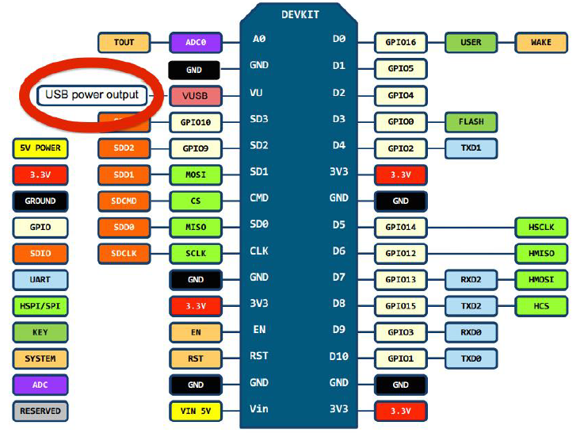
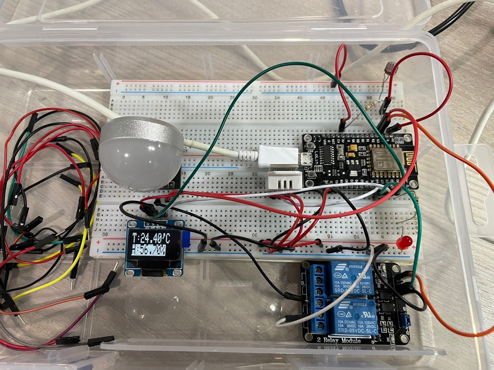

# ✔️ 목표 및 개발환경

목표 : 자동 전등 제어 + 센서 데이터 OLED 출력  

개발 툴 : Arduino IDE 1.8.19  
센서 : CDS sensor(조도 센서), DHT-22(온습도 센서)  
Actuator : LED, USB LED(Lamp)    
MCU : NodeMCU(ESP 8266)  
Module : SSD1306(OLED), 2-channel Relay  
Connector Adapter : USB_A type Adapter(C415)  

[작동 영상 : Youtube](https://youtu.be/c-hRML66dDU)  
[Github Link](https://github.com/kdjun97/iot-led-control-with-oled)  
[회로 재설계(점퍼 선 재배열)](https://kdjun97.github.io/iot/auto-led-circuit-design/)  

---  

## 🛹 ESP8266 pin layout

<a href="https://kdjun97.github.io/assets/images/post_img/iot/auto-led-control-with-oled/esp8266_pin_map.png">
  
</a>  

Arduino IDE Pin #은 GPIO #가 들어가야함.  
귀찮으니 아래처럼 정의해놓고 사용하자.  

```cpp  
#define D0 16
#define D1 5
#define D2 4
#define D3 0
#define D4 2
#define D5 14
#define D6 12
#define D7 13
#define D8 15
```  

---  

## 🔨 회로 구성

<a href="https://kdjun97.github.io/assets/images/post_img/iot/auto-led-control-with-oled/schematic.jpg">
  
</a>  

위 사진과 같이 구성하였음.  
cds, dht22, OLED, LED, Relay + USB Adapter + USB LED + NodeMCU(ESP 8266) 사용  

아래에서 각각 어떤 식으로 동작하는지 코드와 함께 간략히 설명하겠다.  
어디에 핀을 맵핑하고 선을 어떻게 연결하는 디테일한 부분은 일단은 생략하도록 하겠다.  

---  

## 🌀 비동기식 일 처리   

`delay` 함수를 사용하지 않고, 비동기식 일처리를 위해 `millis()`함수를 사용.   

`delay` 함수는 그 시간동안 모든 코드를 `block`해버림.  
`millis()` 함수는 현재 시간을 측정해줌.  
따라서, 경과 시간을 비교하여 쓰레드처럼 돌게 코딩을 하면 쓰레드를 사용하는 효과를 낼 수 있음.  

```cpp
void loop() {
  if (time_snapshot1 + 1000 <= millis()) {
    led_on();
    time_snapshot1 = millis(); 
  }
}
```

---  

## 🖥️ OLED에 원하는 값 출력  

OLED에 dht22로 읽은 온도와 습도를 출력할 수 있음.  
Arduino IDE의 라이브러리 매니저에서 `Adafruit SSD1306`을 install하였다.  
관련된 패키지들을 다 다운받고, 아래와 같이 코드를 작성해주었다.  

헤더 선언, initialize 등 더 자세한 코드는 `위 깃허브 링크`를 참고하자.  

```cpp
display.clearDisplay();

display.setTextSize(2);             // Normal 1:1 pixel scale
display.setTextColor(SSD1306_WHITE);        // Draw white text
  
display.setCursor(0,0);             // Start at top-left corner
display.print(F("T:"));
display.print(temperature);
display.println(F("'C"));
```

---  

## 🔆 조도 읽어오기.  

MCU GPIO의 아날로그 핀을 이용하여 조도 센서 값을 읽어옴.  

조도센서는 빛을 받으면 내부의 전자가 활성화되어 저항 값이 변함.  
`analogRead(pinNum)` 함수를 이용하여 0~1023 사이의 값을 핀에서 받음.  

`millis()`함수를 사용하여 1초마다 조도 값을 읽어오도록 함.  
또한, `threshold`를 정의하여 일정 값 이하로 내려가면 USB LED를 제어하게 함.  
조도를 읽어오는 부분만 간단히 다루고 더 상세한 코드는 `위의 깃허브 링크에서` 다루도록 하겠다.  

```cpp
void loop() {
  if (time_snapshot1 + 1000 <= millis()) {
    fetch_light();
    time_snapshot1 = millis(); 
  }
}

void fetch_light() {
  light_val = analogRead(LIGHT_PIN);
  Serial.print("Light intensity = ");
  Serial.println(light_val);
}
```

---  

## 🚦 LED Control  

`millis()`함수를 이용하여 1초마다 LED 불이 깜빡거리게 함.(Active HIGH, LOW 반복)  
1초마다 LED가 Active HIGH, LOW로 변함(1초마다 깜빡거림)  
led control하는 부분만 첨부하고 `위의 깃허브 링크에서` 상세한 코드를 다루겠다.  

```cpp
pinMode (LED_PIN, OUTPUT);

// LED 깜빡거림.
void led_on() {
  check ? digitalWrite(D0, HIGH) : digitalWrite(D0, LOW);  
  check = !check;
}
```  

---  

## 🔌 USB LED Control

릴레이 모듈에 5V로 구동되는 USB LED램프(추후 220V 전등으로 바꾸면 됨)를 연결하여, 조도센서와 연동.  
`threshold` 이하로 내려가면(어두워지면) 자동으로 USB LED 램프가 켜지도록 설정.  
아래는 간단히 USB LED를 컨트롤하는 코드이다.  
릴레이를 컨트롤하여 USB LED가 컨트롤되게 된다.  

```cpp
#define RELAY1_PIN D4 // HW1을 위해 D4로 맵핑 변경
#define RELAY_OFF HIGH // HIGH 신호이면 릴레이 동작하지 않음
#define RELAY_ON LOW // LOW 신호이면 릴레이 동작함

void setup() {
  pinMode (RELAY1_PIN, OUTPUT); // 릴레이 signal 단자
  relay_state = RELAY_OFF;
  digitalWrite(RELAY1_PIN, relay_state);  
}
```

---   

## 💡 자동 제어 환경 구축

위에서 실험했던 코드를 응용하여 센서들의 값을 OLED에 출력해보고, 자동으로 USB LED를 컨트롤해보는 예제를 만들어보았다.  

`기능`  
1. 1초마다 LED가 깜빡거림.  
1. 온습도 데이터를 1초마다 읽고 OLED에 출력
1. 조도 센서로 밝기를 측정 후, 어두워지면 전등에 불이 10초간 켜짐  
1. 불이 켜지고 10초 안에 다시 불을 켰다가 끄면 10초 카운트 리셋됨

`배운 점`  
1. Arduino에는 thread의 개념이 없기 때문에 `millis()`함수를 사용하여 `non-blocking` code를 구현하였다.  
1. 릴레이를 이용하여 일반 가전기기를 제어할 수 있었다(5V 램프를 220V 전등으로 바꾸면 됨)  
1. MCU GPIO 아날로그 핀을 이용하여 원하는 센서(cds)의 값을 읽어올 수 있었다.  
1. 외부 라이브러리를 이용하여 OLED, DHT22 센서를 다뤄보았다.  
1. MCU의 임의의 핀을 출력 핀으로 사용하여 HIGH/LOW 신호를 가하여 LED를 제어할 수 있었다.  

IoT는 꽤나 매력적인 분야인 것 같다.  
시간이 난다면 조금 더 공부하여 집에 있는 가전제품들, 릴레이와 인터넷을 이용하여 Home Assistant System을 만들어보고 싶다.  

일단 이번 포스팅은 여기서 끝.