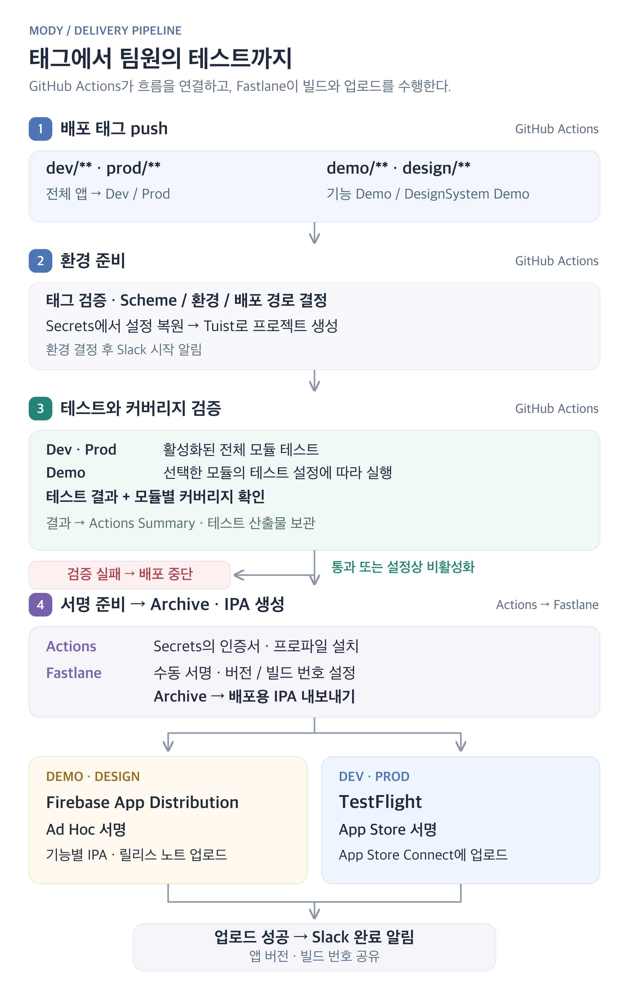

# 🚚 MicroFeature 구조에 맞춰 배포 흐름도 준비하기

> [이전 글: Demo 앱으로 기능별 시나리오 검증하기](https://kdjun97.github.io/ios/demo-app-part2/)  
> [MODY iOS GitHub](https://github.com/Central-MakeUs/mody-ios)  

MODY는 MicroFeature Architecture를 기반으로 설계했다. 기능별로 독립 실행할 수 있는 Demo 타깃을 두고, 전체 앱도 Dev·Prod 환경으로 나눴다. 개발 중인 기능을 팀원에게 보여주거나 전체 앱을 검증하는 과정에서 여러 앱을 자주 배포하게 될 것으로 예상했다.  

그래서 아키텍처를 설계하면서 배포 흐름도 함께 준비했다. MicroFeature Architecture를 실험하던 [micro-feature-study Github](https://github.com/kdjun97/micro-feature-study)에서 이 구조에 맞는 CI/CD를 먼저 구성해 보고, 이후 실제 프로덕트인 MODY의 배포 대상과 환경에 맞춰 적용했다.  

이번 글에서는 GitHub Actions와 Fastlane으로 기능별 Demo와 Dev·Prod 앱의 배포를 자동화하고, 테스트와 팀원 알림까지 연결해 본 경험을 정리해 보려 한다.  

# 🛠️ GitHub Actions와 Fastlane을 선택한 이유

이전에 [오목완 프로젝트](https://kdjun97.github.io/ios/omokwan-cicd/)에서는 **Xcode Cloud로 CI/CD를 구성**했다. 설정 파일과 Tuist 프로젝트를 준비하는 스크립트를 작성하고, 빌드와 TestFlight 배포는 Xcode Cloud에서 제공하는 기능을 연결해 사용했다.  

회사와 다른 프로젝트에서 Xcode Cloud를 사용해 봤기 때문에, MODY에서는 새로운 조합으로 CI/CD를 구성해 보고 싶었다. 실무에서 GitHub Actions와 Fastlane을 많이 사용한다는 이야기를 들어, 직접 프로젝트에 적용하며 두 도구를 익혀보기로 했다.  

MODY에는 기능별 Demo와 Dev·Prod 앱이 있어, 배포 대상에 따라 빌드할 앱과 서명 설정, 업로드 경로를 다르게 구성해야 했다. GitHub Actions에서 실행 조건과 작업 순서를 관리하고, Fastlane에서 빌드·서명·업로드를 처리하는 방식이 내가 설계한 구조에 잘 맞았다.  

이런 부분이 내가 동아리나 사이드 프로젝트를 계속하는 이유 중 하나이기도 한데, **평소 관심 있던 기술을 실제 프로젝트에 적용하고, 개발하면서 필요한 부분까지 고민해 볼 수 있다는 점이 좋았다.**  

아참, 그리고 Github public repository는 표준 GitHub-hosted runner의 실행 요금이 무료라는 것도 결정에 한 몫 했다.  

> [Github Actions billing](https://docs.github.com/en/billing/concepts/product-billing/github-actions)

# 🧭 어떤 앱을 누구에게 전달할지부터 정했다

배포 대상을 나눌 때는 앱을 확인하는 목적부터 생각했다.  

기획자와 디자이너가 특정 화면을 확인할 때는 해당 기능의 Demo 앱을 전달하고 싶었다. 예를 들어 챌린지 화면을 확인하는데 전체 앱을 설치하고 그 화면까지 찾아갈 필요는 없었다. 공통 UI를 확인하는 DesignSystem Demo도 같은 목적이었다.  

Demo의 배포 경로로는 **Firebase App Distribution**을 선택했다. 회사에서 사용해 봤을 때 비개발자 동료들이 편하게 이용했던 경험이 있어, MODY에서도 사용해 보고 싶었다.  

개발 환경과 운영 환경에 연결한 전체 앱은 각각 Dev·Prod로 나누고 TestFlight로 전달했다. 두 배포 방식을 모두 직접 구성해 보고 싶은 마음도 있었다.  

대상이 정해지고 나니 다음은 배포 시점을 정할 차례였다. 일반 커밋을 push할 때마다 앱을 전달하기보다는, 팀원에게 보여줄 준비가 됐을 때 태그를 붙이도록 했다.  
예를 들어 `demo/ChallengeDemo/1.0.0-2610261400`이라는 태그를 push하면 챌린지 Demo를 Firebase로 보내고, `dev/1.0.0-2610261410`이면 개발 환경의 전체 앱을 TestFlight로 보내는 식이다. 같은 버전의 수정본도 다시 전달할 수 있도록 시각을 함께 넣었다.  

태그를 받은 뒤에는 배포 대상과 형식부터 검사했다. 잘못된 입력이라면 프로젝트를 생성하고 빌드하기 전에 중단하도록 했다.  
그 이후의 환경 준비와 프로젝트 생성은 공통으로 사용하고, 대상에 따라 Scheme과 서명 설정, 업로드 경로를 선택하게 했다. 앱마다 배포 과정을 따로 만드는 대신, **공통 과정은 함께 사용하면서 필요한 차이만 반영하는 방식**으로 구성했다.  

태그 push부터 테스트와 빌드, 배포, Slack 알림까지 이어지는 전체 흐름을 그림으로 정리하면 다음과 같다.  

  

이 과정에서 특히 신경 쓴 부분은 여러 앱의 서명 관리, 배포 전 검증, 팀원에게 결과를 전달하는 방식이었다.  

# 🔐 여러 앱의 서명과 배포 설정 관리하기

구현하면서 특히 기억에 남는 부분은 서명이었다.  

초기에는 배포할 때마다 Apple Developer의 인증서가 늘어나는 현상을 겪었다. 같은 앱을 반복해서 배포하는데 인증서가 계속 추가되니, CI가 어떤 자산으로 서명하는지 직접 살펴보고 관리할 필요를 느꼈다.  
이 과정에서 Apple Developer에 인증서가 등록되어 있는 것만으로는 충분하지 않다는 점을 이해했다. 실제 빌드를 수행하는 머신에는 인증서에 대응하는 개인 키가 있어야 하고, 앱과 배포 방식에 맞는 Provisioning Profile도 필요했다.  
그래서 CI에서 사용할 서명 자산을 미리 정해 두는 수동 서명 방식으로 구성했다. 인증서와 개인 키가 담긴 `.p12`, 배포 대상별 Profile을 GitHub Secrets에 보관하고 실행할 때 복원해 사용했다.  
인증서를 만들거나 갱신하는 작업과 매번 앱을 빌드하는 작업을 분리한 것이다.  

기능별 Demo가 많다는 점도 신경 써야 했다. Demo마다 서명 설정을 따로 관리하면 기능을 추가할 때마다 관리할 항목도 늘어났다. 이를 줄이기 위해 Bundle ID에 공통 규칙을 적용하고, 적용 가능한 Demo끼리는 wildcard App ID에 연결한 Ad Hoc Profile을 공유하도록 했다.  
이렇게 구성해도 인증서가 만료되거나 새 테스트 기기를 등록하면 자산을 갱신해야 한다. 자동화를 구성하면서 **계속 직접 관리해야 하는 부분이 어디인지**도 알게 됐다.  

기능을 쉽게 추가할 수 있는 구조를 만드는 것과, 늘어난 앱을 계속 배포할 수 있도록 관리하는 것은 함께 고민해야 하는 일이었다.  

# 🧪 배포가 되는 것에서, 배포해도 되는지 확인하는 것으로

처음에는 빌드와 업로드를 연결하는 데 집중했다. 이후 모듈별 테스트를 작성하면서 이 테스트도 배포 전에 실행하도록 CI에 연결했다.  
빌드에 성공하더라도 기존 동작이 달라졌을 수 있다. 기능을 추가하거나 수정하면서 다른 동작에 영향을 줬다면, 팀원이나 사용자에게 전달하기 전에 확인할 기회를 만들고 싶었다.  

테스트 범위는 배포 대상에 맞췄다. Dev·Prod는 테스트를 활성화한 모듈 전체를 검사하고, 기능별 Demo는 해당 모듈을 검사하도록 했다.  
검사 대상에는 테스트 통과와 최소 커버리지 기준을 함께 적용했다. 커버리지 기준은 모듈별로 관리해, 전체 평균에 특정 모듈의 부족한 부분이 가려지지 않도록 했다.  
테스트를 연결한 뒤에는 실패했을 때 무엇을 확인할지도 중요해졌다. 배포가 중단됐다는 사실만 알면 원인을 찾기 위해 다시 로그를 뒤져야 했다.  
그래서 Actions 실행 요약에 모듈별 테스트 결과와 커버리지를 남겼다. 테스트 자체가 실패했는지, 테스트는 통과했지만 커버리지 기준에 못 미쳤는지 구분해서 볼 수 있도록 했다.  

> [GitHub Actions에서 실제 테스트·배포 실행 기록 보기](https://github.com/Central-MakeUs/mody-ios/actions/runs/38749257519)  

이 과정에서 고민하는 범위가 조금 달라졌다. 처음에는 앱을 자동으로 만들어 올리는 데 관심이 있었다면, 테스트를 연결하면서는 **어떤 확인을 거친 앱을 전달할 것인지**까지 생각하게 됐다.  
물론 테스트를 실행한다고 모든 문제를 발견할 수 있는 것은 아니다. 어떤 동작을 테스트로 검증할지 계속 고민해야 한다. 그래도 작성한 테스트를 배포 과정에서 함께 실행하도록 연결했다는 점에서 의미가 있었다.  

# 💬 팀원에게 전달하는 과정까지 연결하기

업로드가 끝난 뒤에는 Slack으로 앱과 환경, 버전, 빌드 번호를 전달하도록 했고 실패한 경우에는 어느 단계에서 문제가 생겼는지도 알림에 표시했다.  
같은 앱 버전으로 수정본을 여러 번 공유할 수 있어, 알림에는 실제 업로드에 사용한 빌드 번호를 반영했다. 팀원이 확인할 앱을 구분할 수 있게 하려는 목적이었다.  
알림까지 연결하고 나니 처음 Demo 앱을 만들 때 생각했던 흐름이 이어졌다. 기능을 개발하고, 확인할 앱을 선택해 배포하고, 팀원이 직접 실행해 보는 과정이다.  
팀원들은 Demo 앱으로 개발 중인 화면을 확인할 수 있었고, 진행 상황과 구현된 결과물을 파악하기 수월했다는 의견도 주었다. 내가 설계한 구조가 실제 협업에서 어떻게 쓰이는지 확인할 수 있었던 부분이다.  

# 🌱 직접 구성해 보며 느낀 점

연차가 쌓이면서 기능을 구현하는 것뿐 아니라, 개발한 결과물을 팀원에게 어떻게 공유하고 함께 이야기할지도 점점 더 고민하게 됐다.  

Slack이나 Discord에 Webhook을 연결해 개발·배포 소식을 공유하는 것도 그 고민에서 시작한 시도다. 서로 다른 역할의 팀원들이 진행 상황을 쉽게 확인하고 의견을 나눌 수 있도록 여러 방법을 적용해 보고 있다. 앞으로도 만날 다양한 팀에서도 더 잘 맞는 소통 방식이 있을지 계속 찾아보고 싶다.  

또, GitHub Actions와 Fastlane을 사용해 보면서 좋았던 점은 내가 생각한 배포 흐름을 세밀하게 직접 구성해 볼 수 있다는 것이었다. 그만큼 결정하고 관리할 부분도 많았다.  
어떤 앱을 배포할지, 어떤 테스트를 거칠지, 어떤 서명 자산을 사용할지 하나씩 정해야 했다. 인증서 문제를 살펴보거나 실패한 실행의 로그를 정리하는 과정도 필요했다. 이를 직접 다루면서 이전에는 도구의 설정으로 연결해 사용했던 빌드와 배포 과정을 더 구체적으로 이해할 수 있었다.  

MODY는 더 큰 규모의 앱과 협업 환경을 가정해 여러 구조를 시도한 프로젝트였다. 현재 규모에 비해 준비한 것이 많다는 생각도 있지만, 기능을 나누는 설계부터 검증과 배포, 팀원에게 전달하는 과정까지 직접 연결해 볼 수 있었다.  

직접 설정하고 문제를 해결해 본 덕분에, 앞으로 다른 환경에서도 프로젝트의 요구사항에 맞는 CI/CD를 설계하고 구성해 볼 수 있겠다는 자신감이 생겼다.  
~~CI/CD... 구성해놓으면 참 편리하다 ㅋ~~  
