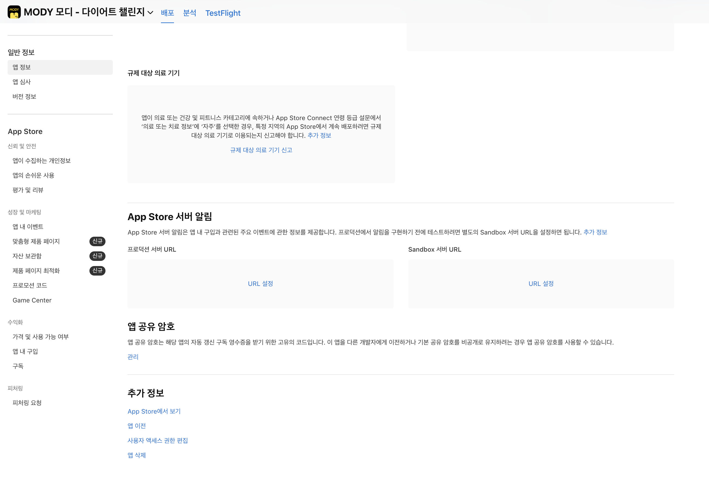
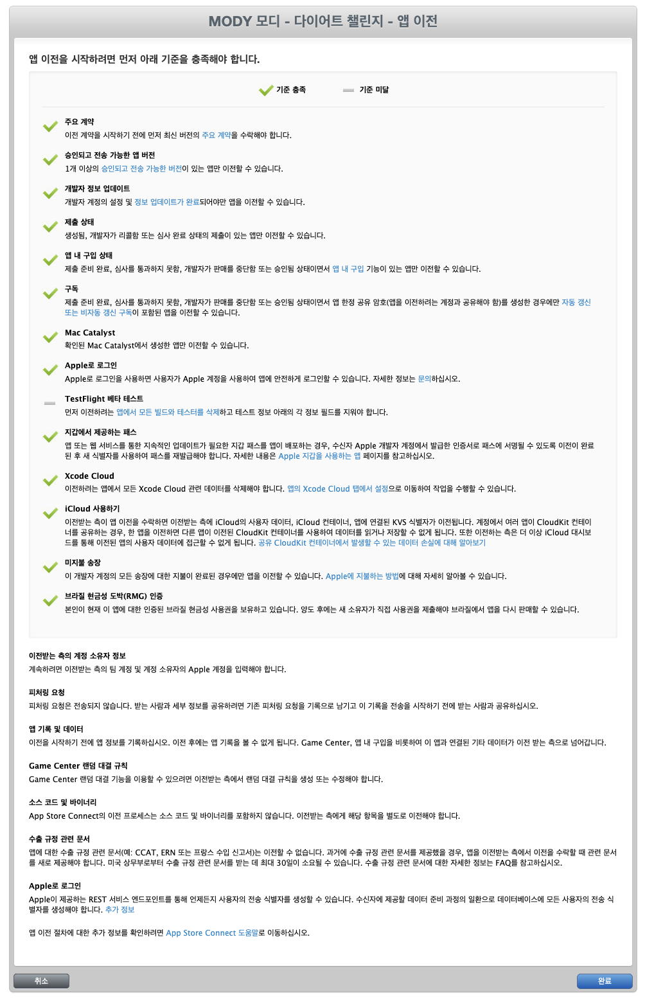
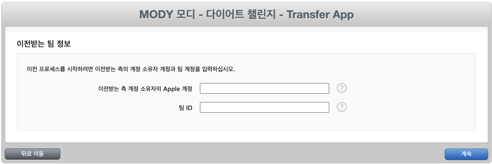
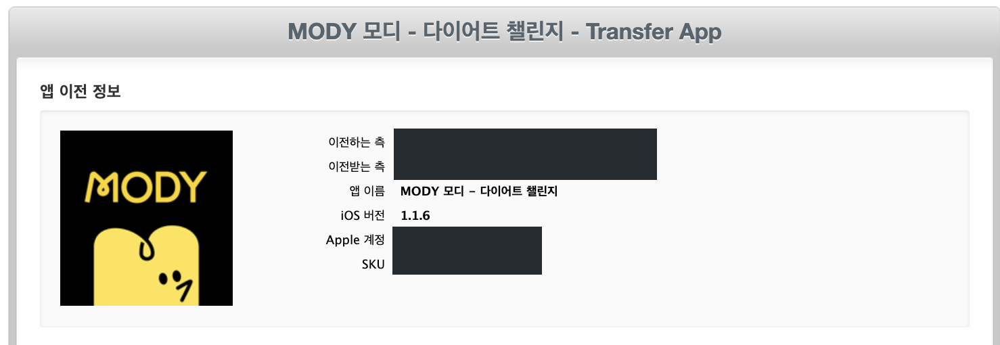
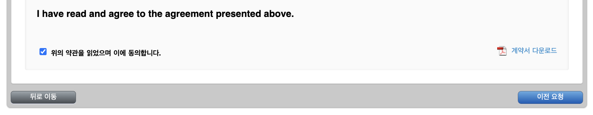
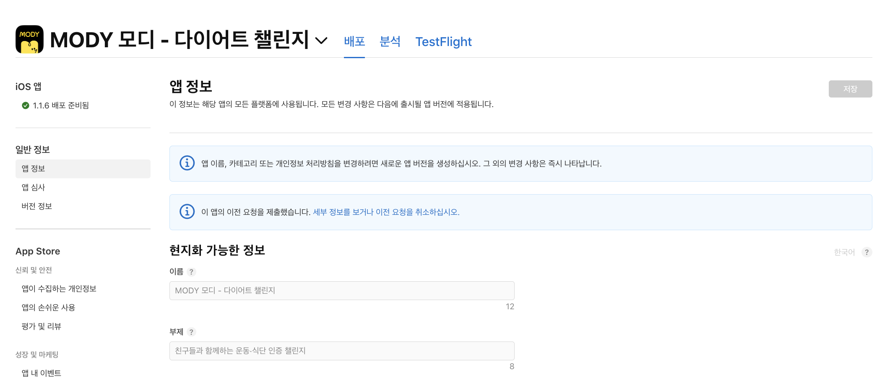
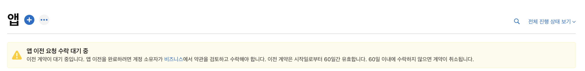
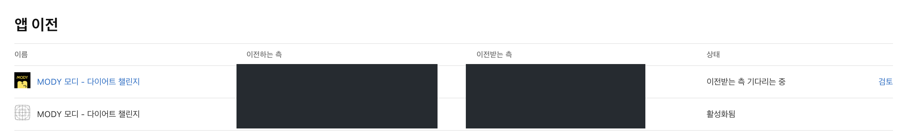
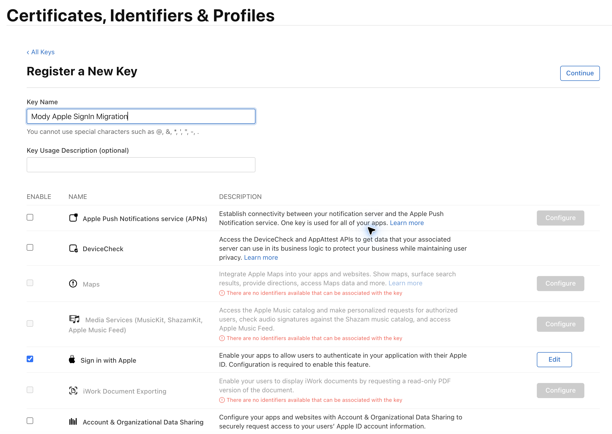
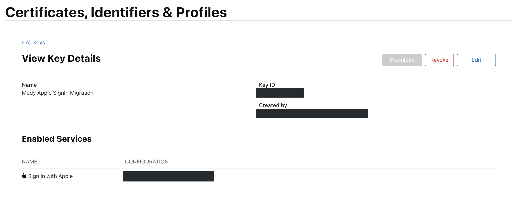

# 📦 앱 이전

**<u>글 작성에 앞서, 앱 이전은 어려운 작업이 아니니 겁먹지 말도록 하자.</u>**  

기존에 개발하고 운영하던 앱을 다른 개발자에게 이전하게 됐다.  
소스 코드와 개발 환경을 전달하는 것에 더해, 내 Apple Developer 팀에 등록된 앱도 새로운 개발자의 팀으로 옮겨야 했다.  

App Store Connect의 **앱 이전(App Transfer)** 기능을 사용하면 Bundle ID와 평점·리뷰를 유지하면서 앱의 소유권을 다른 팀으로 옮길 수 있다. 이후 업데이트는 새 팀에서 이어가게 된다.  

> [Apple 앱 이전 개요](https://developer.apple.com/help/app-store-connect/transfer-an-app/overview-of-app-transfer/)  

앱 이전 자체는 준비만 된다면 엄청 빨리 되는 것 같다.  
내가 이전을 신청하고 새 개발자가 수락하니 거의 바로 반영됐다. 정확히 측정하지는 않았지만, 체감상 5분도 걸리지 않은 것 같다.  
물론 Apple 안내상 완료까지 최대 2영업일이 걸릴 수 있으므로 항상 이 속도로 끝난다는 뜻은 아니다.  

> [이전 수락 안내](https://developer.apple.com/help/app-store-connect/transfer-an-app/accept-an-app-transfer/)  

시간을 쓴 부분은 그 전후였다.  
특히 **기존 Apple 로그인 회원을 새 팀에서도 같은 회원으로 연결하는 과정**에서 애를 먹었다.  
결국 이미 넘긴 앱을 한 번 돌려받기까지 했다.  

이 글에서는 당시 캡처한 화면을 따라 앱 이전 절차를 정리하고, 가장 오래 걸렸던 **Apple 로그인 사용자 이전 과정**을 함께 남겨보려고 한다.  

# 📝 앱 이전 자체는 두 단계면 끝

Apple이 안내하는 앱 이전 절차는 크게 보면 간단하다.  

**1.** 기존 팀의 Account Holder가 수신 팀의 `Apple Account(Email)`와 `Team ID`를 입력해 이전을 신청한다.  
**2.** 수신 팀의 Account Holder가 App Store Connect에서 요청을 확인하고 수락한다.  

이전 조건을 갖췄다면, 앱 소유권을 옮기기 위해 양쪽에서 할 일은 이 두 단계다. 화면에서 안내하는 내용을 확인하며 진행하면 되므로 **앱 이전 자체는 크게 어렵지 않다.**  

다만 앱을 넘기기 전에 준비할 것들은 있다. 기존 회원이 계속 로그인하고, 새 개발자가 앱을 운영하고 업데이트할 수 있도록 필요한 정보와 권한을 먼저 정리해야 한다. 사전 준비와 실제 이전 화면을 나눠서 살펴보자.  

> [Apple 이전 신청 안내](https://developer.apple.com/help/app-store-connect/transfer-an-app/initiate-an-app-transfer/)  
> [Apple 이전 수락 안내](https://developer.apple.com/help/app-store-connect/transfer-an-app/accept-an-app-transfer/)  

# 🧰 앱을 이전하기 전에 준비할 것

**1. 수신 팀 정보와 앱 이전 조건 확인하기**  

먼저 이전받는 팀의 **Account Holder Apple 계정 이메일과 Team ID**를 전달받는다.  
앱 이전 신청에 입력하는 정보이며, Apple 로그인 사용자 이전에도 같은 수신 Team ID를 사용한다.  

계약과 앱 상태 등 Apple이 안내하는 이전 조건도 확인하고, 필요한 앱 정보는 미리 백업해 둔다.  
조건을 충족하지 못한 항목은 이전 신청 화면의 체크리스트에서 확인할 수 있다.  

> [Apple 앱 이전 개요](https://developer.apple.com/help/app-store-connect/transfer-an-app/overview-of-app-transfer/)  

**2. TestFlight 빌드 만료시키기**  

이전 신청 전에 **TestFlight에 올라간 빌드 중 아직 만료되지 않은 빌드는 모두 만료시켜 베타 테스트를 종료**해야 한다.  
App Store Connect에서 **앱 선택 → TestFlight → 플랫폼 선택 → 각 빌드 선택 → Expire Build** 순서로 처리하면 된다. 버전이 여러 개라면 각 버전의 빌드까지 확인한다.  

Apple의 앱 이전 안내에는 모든 빌드와 테스터를 테스트 대상에서 제거하고, 각 언어의 **Test Information** 항목도 비우도록 되어 있다. 빌드 만료와 함께 이 부분도 이전 전에 확인해 두면 좋다.  

> [Apple 앱 이전 개요 — Apps using TestFlight](https://developer.apple.com/help/app-store-connect/transfer-an-app/overview-of-app-transfer/)  
> [TestFlight 빌드 테스트 중단 안내](https://developer.apple.com/help/app-store-connect/test-a-beta-version/stop-testing-a-build/)  

**3. Apple 로그인 사용자 이전 준비하기**  

**나는 이걸 미리 안 해놔서 앱을 이전했다가 다시 받았다.. 애플 로그인을 연동한 앱들은 꼭 확인해보자.**   

당시 내 앱은 iOS에서 받은 `identityToken`을 서버가 **Apple의 공개 키로 검증하는 방식**이라, 내 로컬에 `.p8` 키가 없어도 기존 로그인은 잘 동작했다.  
> [Apple 로그인 토큰 검증 안내](https://developer.apple.com/documentation/signinwithapple/verifying-a-user)  

하지만 앱을 다른 팀으로 이전할 때는 <u>기존 회원을 연결하는 작업이 별도로 필요</u>하다.  
Apple 로그인 식별자는 개발자 팀마다 다르기 때문에, 기존 식별자(`apple_sub`)를 새 팀에서 그대로 사용할 수는 없다. Apple은 이를 연결할 수 있도록 **사용자 이전 API**를 제공한다.  

기존 팀의 `.p8` 키로 인증하고, 기존 `apple_sub`와 **새 개발자의 Team ID**를 이 API에 보내면 `사용자별 이전용 값`을 발급받을 수 있다. 이때 받는 값이 **`transfer_sub`**다.  
새 팀은 이 값을 자기 팀의 Apple 로그인 식별자로 교환해, 이전 전후의 사용자를 같은 회원으로 연결한다.  

Apple은 앱을 넘기기 전에 이 이전용 값을 생성하고 전달할 데이터를 준비하도록 안내한다. 받는 팀은 **앱 이전을 수락한 날부터 60일 안에** 식별자 교환을 끝내야 한다.  

> [Apple 사용자 이전 기술 문서 TN3159](https://developer.apple.com/documentation/technotes/tn3159-migrating-sign-in-with-apple-users-for-an-app-transfer)  
> [Apple 양도 팀 절차](https://developer.apple.com/documentation/signinwithapple/transferring-your-apps-and-users-to-another-team)  

**4. 운영 서비스와 배포 환경 인계하기**  

소스 코드와 서버, 외부 서비스의 관리 권한은 앱 이전만으로 함께 넘어가지 않으므로 새 개발자에게 필요한 접근 권한을 준비한다. Firebase·Kakao·AASA와 CI/CD 설정에서 새 팀의 키나 정보로 바꿔야 할 항목도 함께 확인해 둔다.  

# 🖥️ 실제 앱 이전 절차

준비가 끝났다면 기존 팀에서 앱 이전을 신청하고 새 팀에서 수락하면 된다. 먼저 보내는 쪽의 화면부터 살펴보자.  

**1. 보내는 쪽에서 이전 신청하기**  

`앱 정보에서 이전 시작하기`  

App Store Connect에서 이전할 앱을 선택하고, **앱 정보 → 추가 정보 → 앱 이전**으로 들어간다.  

<a href="https://kdjun97.github.io/assets/images/post_img/ios/app-migration/01-app-transfer-entry.png" target="_blank" rel="noopener noreferrer">
  
</a>  

`이전 조건과 TestFlight 상태 확인하기`  

다음 화면에서는 계약, 앱 상태, Apple 로그인, TestFlight 등 이전 조건을 확인한다.  
내가 찍어둔 화면에서는 **TestFlight 베타 테스트가 기준 미달**로 표시되어 있었다.  
앞에서 적은 빌드 만료와 테스트 정보 정리를 먼저 해야 하는 이유다.  

<a href="https://kdjun97.github.io/assets/images/post_img/ios/app-migration/02-transfer-eligibility-testflight.png" target="_blank" rel="noopener noreferrer">
  
</a>  

Apple 로그인 항목이 충족되어 있어도, 앞에서 설명한 사용자 식별자 이전은 별도로 진행해야 한다.  

`수신 팀 정보 입력하기`  

조건을 충족한 뒤에는 **이전받는 쪽 Account Holder의 Apple 계정과 Team ID**를 입력한다.  

<a href="https://kdjun97.github.io/assets/images/post_img/ios/app-migration/03-recipient-account-and-team.png" target="_blank" rel="noopener noreferrer">
  
</a>  

`이전 정보와 약관 확인 후 요청하기`  

이전하는 쪽과 받는 쪽, 대상 앱을 확인하고 약관을 읽은 뒤 <u>이전을 요청</u>한다.  

<a href="https://kdjun97.github.io/assets/images/post_img/ios/app-migration/04-transfer-parties-review.png" target="_blank" rel="noopener noreferrer">
  
</a>  

<a href="https://kdjun97.github.io/assets/images/post_img/ios/app-migration/05-transfer-agreement-submit.png" target="_blank" rel="noopener noreferrer">
  
</a>  

요청을 보내면 **이 앱의 이전 요청을 제출했습니다**라는 안내가 표시된다. 이제 받는 쪽에서 수락하면 된다.  

<a href="https://kdjun97.github.io/assets/images/post_img/ios/app-migration/06-transfer-request-submitted.png" target="_blank" rel="noopener noreferrer">
  
</a>  

**2. 받는 쪽에서 이전 수락하기**  

받는 쪽의 Account Holder는 App Store Connect의 **비즈니스 → 앱 이전 → 검토**에서 요청과 필요한 정보를 확인하고 수락한다.~~사실 그냥 메일이 오는데 그거 눌러도 됨~~  
수락 후 Apple의 처리가 완료되면 새 팀에서 앱을 관리할 수 있다.  

아래에서 설명할 앱을 돌려받는 과정에서는 내가 이 수신자 절차를 직접 거치게 됐다.  
~~앱 이전을 하면서 받는 쪽의 절차도 같이 경험해본....~~  

> [Apple 이전 수락 안내](https://developer.apple.com/help/app-store-connect/transfer-an-app/accept-an-app-transfer/)  

# 🔑 가장 애먹었던 Apple 로그인 이전

⚠️ 주의 : 나의 경우 앱을 이전한 뒤 Apple 로그인 사용자 정보를 옮기려다 `.p8` 키가 없다는 걸 알게 돼, **앱을 다시 돌려받고 키를 생성한 뒤 `transfer_sub`를 발급받았다.**  
**<u>이 글을 보시는 분들의 시간은 소중하니 꼭 미리 확인하길 바란다.</u>**  
{: .notice--warning}  

앱을 다시 돌려받는 과정은 번거로웠지만, 준비를 마친 뒤 `transfer_sub`를 발급받는 작업 자체는 간단했다. 서버 측에서 CSV를 미리 준비해 준 덕분에 발급 작업은 체감상 5~10분 정도 걸렸다.  

먼저 서버 측에 Apple 로그인 회원 목록을 요청해 **회원 식별자와 `apple_sub`가 담긴 CSV 파일**을 받았다.  
이 파일을 바탕으로 사용자별 `transfer_sub`를 발급받아 전달하면, 새 팀에서 기존 회원과 연결할 수 있다. 전체 흐름은 다음과 같다.  

```text
회원 식별자 ↔ 기존 apple_sub
                 ↓ 기존 팀 인증 + 새 팀의 Team ID
             transfer_sub
                 ↓ 새 팀 인증으로 교환
회원 식별자 ↔ 새 팀의 sub
```

**내가 할 일은 사용자별 `transfer_sub`를 생성해 새 개발자에게 전달하는 데까지였다.** 이후 새 팀의 Apple 로그인 식별자로 교환하고 기존 회원 정보에 연결하는 작업은 새 개발자와 서버 측에서 담당한다.  

`내 로컬 키와 새 개발자의 Team ID는 어디에 쓰일까?`  

이 작업에는 기존 팀의 **Sign in with Apple용 `.p8` 개인 키**, Key ID, 기존 Team ID, 이전할 앱의 client ID, 수신 Team ID가 필요했다. iOS 앱의 client ID에는 해당 Bundle ID를 사용한다.  

`.p8` 키는 내 팀의 요청임을 증명하는 JWT인 `client_secret`을 서명하는 데 사용한다. 이후 Apple API를 호출하는 흐름은 다음과 같다.  

1. 기존 팀의 `.p8` 키로 `client_secret`을 만든다.
2. `/auth/token`에 `grant_type=client_credentials`, `scope=user.migration`과 client 정보를 보내 작업용 `access_token`을 받는다.
3. `/auth/usermigrationinfo`에 기존 사용자 `sub`와 수신 Team ID를 보내 `transfer_sub`를 받는다.

새 개발자의 Team ID는 **3번 요청의 `target` 필드**에 넣는다. 자세한 요청 형식은 아래 공식 문서에서 확인할 수 있다.  

> [Apple 이전 식별자 생성 API](https://developer.apple.com/documentation/signinwithapple/transferring-your-apps-and-users-to-another-team)  

`그런데 사용할 수 있는 .p8 키가 없었다`  

앱을 넘긴 뒤 이 작업을 하려니, 인증에 필요한 **Sign in with Apple용 `.p8` 키를 만들어 두지 않은 상태**였다. 새로 발급하려 해도 앱이 이미 새 팀으로 넘어가 있어 내 팀에서 운영 앱을 Primary App ID로 선택할 수 없었다.  

`앱을 돌려받아 키를 만들고 다시 이전했다`  

결국 새 개발자에게 앱을 **원래 내 팀으로 다시 이전**해 달라고 했다.  
Apple Support에 문의할 수도 있었지만, 내 상황에서는 앱을 돌려받아 처리하는 편이 빠르겠다고 판단했다.  

앱을 돌려받기 위한 요청이 도착하자 내 App Store Connect에 **앱 이전 요청 수락 대기 중** 안내가 나타났다.  

<a href="https://kdjun97.github.io/assets/images/post_img/ios/app-migration/07-return-transfer-awaiting-acceptance.png" target="_blank" rel="noopener noreferrer">
  
</a>  

비즈니스 화면의 **앱 이전** 목록에는 이전에 보냈던 건과 다시 받는 요청이 함께 보였다. 다시 받는 요청은 **이전받는 측 기다리는 중** 상태였고, 오른쪽 **검토**에서 수락 절차로 들어갈 수 있었다.  

<a href="https://kdjun97.github.io/assets/images/post_img/ios/app-migration/08-return-transfer-business-review.png" target="_blank" rel="noopener noreferrer">
  
</a>  

요청 알림에 표시된 60일은 **앱 이전 요청을 수락할 기한**이다. 앞에서 설명한 **수락 후 Apple 로그인 식별자를 교환하는 60일**과는 시작 시점이 다르다.  

앱을 수락해 내 팀으로 돌려받은 뒤에는 다음 순서로 키를 준비했다.  

1. Apple Developer의 **Certificates, Identifiers & Profiles → Keys**에서 새 키를 생성
2. **Sign in with Apple**을 활성화하고, 이전할 운영 앱을 Primary App ID로 연결
3. `.p8` 파일을 내려받고 Key ID를 준비

<a href="https://kdjun97.github.io/assets/images/post_img/ios/app-migration/09-register-sign-in-with-apple-key.png" target="_blank" rel="noopener noreferrer">
  
</a>  

키를 만든 뒤 상세 화면에서 **Enabled Services에 Sign in with Apple이 있는지**, 대상 앱에 연결되어 있는지도 확인했다. 아래 이미지는 키 생성 후 상세 화면이며, Key ID와 생성자·팀 식별 정보는 가렸다.  

<a href="https://kdjun97.github.io/assets/images/post_img/ios/app-migration/10-sign-in-key-details.png" target="_blank" rel="noopener noreferrer">
  
</a>  

키를 준비한 뒤에는 Python 스크립트로 CSV를 한 행씩 읽으며 Apple의 사용자 이전 API를 호출했다. 각 `apple_sub`와 새 개발자의 Team ID를 보내 `transfer_sub`를 발급받고, 회원 식별자와 함께 정리해 전달했다. 이후 앱을 새 개발자에게 다시 이전하면서 내 쪽 작업을 마무리했다.  

앱을 돌려받은 것은 이번에 키 문제를 해결하기 위해 내가 택한 방법이었다.  

# 🧰 마무리 작업들...

앱 이전과 `transfer_sub` 전달은 마무리했지만, 운영 환경에는 아직 내 계정으로 설정된 값들이 남아 있다. Firebase, Kakao, AASA와 CI/CD 설정에서 새 개발자의 키나 팀 정보로 바꿔야 할 부분을 확인하고, 함께 적용해 나가면 된다.  
새로운 개발자가 문제 없이 새로운 버전으로 업데이트 하면 비로소 앱 이전이 완료된다. 이 점만 나중에 확인하도록 하자. ~~(나는 확인 완료. 찐 App Transfer 완료)~~  

결국 중요한 건 **새 개발자가 앱을 맡으면서 달라지는 사항을 함께 점검하고, 필요한 변경을 하나씩 적용하며 이전하는 것**이다. 새 인증 정보를 적용한 버전이 배포되고 정상 동작하는지 확인한 뒤, 더 이상 사용하지 않는 내 키와 접근 권한도 정리할 예정이다.  

앱을 넘기는 건 금방이었지만, 다음에는 Apple 로그인 이전에 필요한 키와 데이터부터 준비해 둘 생각이다.  
