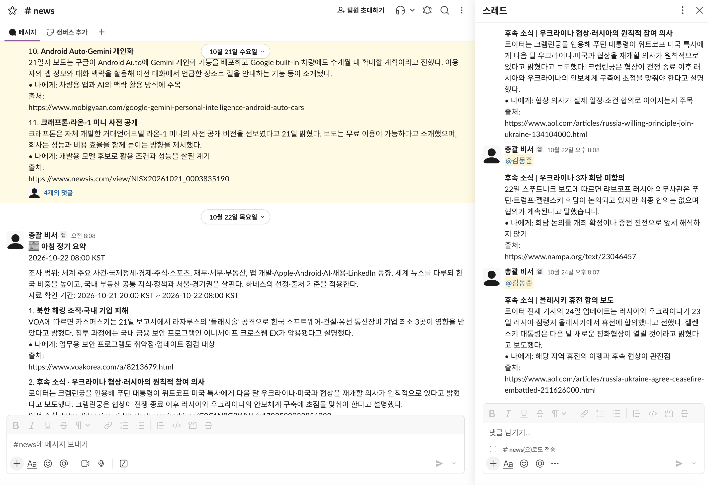
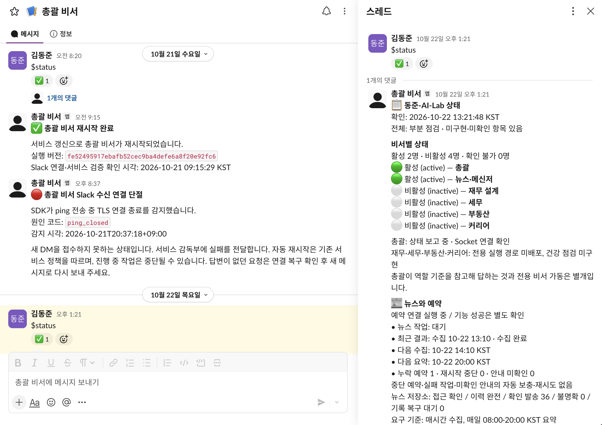

# 🤔 나만의 비서를 만들어보자

라즈베리파이에서 돌아가는 개인 AI 비서를 만들어봤다.  
AI가 나오면서 늘 나만의 비서를 만들어보자는 생각을 했고 드디어 ~~미뤄뒀던~~생각하던 프로젝트를 시작하게 된 것이다.  

큰 목표는 **내 생활에 필요한 여러 일을 맡아주는 개인 비서**를 만드는 것이다. 뉴스뿐 아니라 재무·세무·부동산·커리어처럼 다양한 주제로 기능을 넓혀가고 싶어 분야별 역할과 기준도 정리해뒀다. 그 첫 기능으로 관심 있는 뉴스와 경제·주식 소식을 정리해서 보내주는 기능부터 붙여봤다. 궁금한 것이 생기면 Slack에서 물어볼 수 있도록 대화 기능도 함께 만들었다.  

나는 이미 라즈베리파이를 개인 서버로 사용하고 있었다. [원격 접속 환경](https://kdjun97.github.io/etc/iphone-remote-development-environment-build/)을 만들어 밖에서도 상태를 확인할 수 있게 했고, [MQTT 상태와 오류를 Slack으로 받는 기능](https://kdjun97.github.io/iot/receive-mqtt-log-with-slack/)처럼 원격 로그 분석 기능도 붙여둔 상태였다.  
이 라즈베리파이 환경을 활용해서 그 안에 비서를 만드는 프로젝트를 하였다.  
참고로 나는 AI 도구는 Codex를 개인적으로 사용하고 있었기 때문에, Codex를 사용해 이 프로젝트를 진행하였다.  

Slack 에서 뉴스 봇이 어떻게 작동하고 있는지에 대한 스크린샷을 첨부하며 포스팅을 시작해본다.  

<a href="https://kdjun97.github.io/assets/images/post_img/ai/2026/personal-assistant-ai/slack_news.png" target="_blank" rel="noopener noreferrer">
  
</a>  

# 🔧 어떻게 동작하는가

라즈베리파이는 모델을 직접 구동하는 대신 **질문 수신, 예약 실행, 결과 전달과 기록 관리**를 맡는다. 실제 AI 처리는 원격 모델을 이용하고, Python 서비스는 `systemd`로 관리한다. Mac이나 휴대폰은 필요할 때 원격으로 접속하는 관리 도구로 사용하게 했다.  

**Slack에서 질문하기**  

```text
Slack에서 질문
  → Raspberry Pi의 Python 서비스
  → Codex CLI로 원격 AI 호출
  → Slack으로 답변
```  

Slack의 `Socket Mode`로 질문을 받고, AI의 답변을 원래 질문의 **스레드**에 보내도록 했다.  
스레드로 보내도록 한 이유는 해당 질문에 대한 답변을 한 곳에서 관리하기 위해서였다.  

**뉴스를 모으고 요약해서 보내기**  

뉴스는 질문을 기다리지 않고 **Python 서비스의 예약 일정에 따라 실행한다.** AI가 Codex CLI의 웹 검색으로 관심 분야의 공개 발표와 보도를 조사하고, Python이 조사 결과와 출처를 저장하는 방식이다.  

```text
예약 실행 → 웹 검색으로 뉴스 조사
  → 이전에 보낸 내용과 비교
  → 새 소식 선정·요약 → Slack 전달·기록
```  

처음에는 **뉴스를 매시간 수집하고, 아침·저녁에 정기 요약을 보내도록 했다.** 시간별 수집 결과를 저장해두고, 정기 요약 때 이를 참고하면서 최근 12시간의 뉴스를 다시 조사하도록 했다. 모아둔 기사를 그대로 이어 붙이는 대신, 관련성이나 영향 등을 고려해 읽을 소식을 고르는 방식이었다.  

이렇게 만든 이유는 **뉴스를 더 세세하게 받아보고 싶어서였다.** 실제로 사용해보니 매시간 AI로 뉴스를 조사하는 데 드는 토큰 소모가 부담이 됐다. 그래서 **매시간 수집하는 방식은 사용하지 않기로 했다.**  

이전에 전달한 기록과 비교해 반복되는 내용은 제외하고, 새 소식에는 짧은 요약과 의미·출처를 붙여 Slack으로 보낸다. **이미 다룬 사건에 추가 소식이 생기면 기존 뉴스 스레드에 이어서 전달한다.** 전송 결과도 기록해 다음 뉴스와 비교할 때 활용한다.  

현재 개발한 중심 기능은 다음과 같다.  

- **뉴스 요약:** 관심 분야의 소식을 조사하고, 이전에 전달한 내용과 비교해 새 소식을 정리한다.  
- **Slack 대화:** 비서에게 질문하고 같은 스레드에서 답변을 받는다.  
- **상태·오류 확인:** 서비스 상태를 조회하고, 작업 실패 안내와 진단 기록으로 문제를 확인한다.  

또한, 전용 명령어 기능을 추가했다. Slack에서 `$status` 라는 전용 명령어로 비서의 상태를 조회하고, 재시작이나 연결 오류 알림도 받아볼 수 있다.  

<a href="https://kdjun97.github.io/assets/images/post_img/ai/2026/personal-assistant-ai/slack_status.png" target="_blank" rel="noopener noreferrer">
  
</a>  

현재 구현의 중심은 Slack 대화와 정기 뉴스이며, 각 분야의 전용 비서가 자동으로 협업하는 기능은 앞으로 확장할 부분이다.  

# ⚖️ ChatGPT 예약 기능·dots·내 비서 비교

간단한 뉴스 요약이라면 `ChatGPT 예약` 기능으로도 충분하다. **dots**는 2026년 9월 29일 공개된 상시 에이전트로, 대화 사이에도 맡은 일을 이어간다고 한다. 둘 다 ChatGPT가 제공하므로 직접 서버와 코드를 관리하는 부담이 적다.  

내 비서는 **라즈베리파이에서 예약 실행과 Slack 연동을 직접 관리하는 방식**이다. 뉴스 수집 기준부터 기록·전달 방식, 앞으로 연결할 서비스까지 코드로 바꿀 수 있어 **커스터마이징의 자유가 크다.** 대신 서버와 코드를 계속 관리해야 한다는 포인트는 존재한다.  

| 비교할 점 | ChatGPT 예약 기능 | dots | 내가 만든 비서 |
|---|---|---|---|
| 유지보수 | 직접 관리할 부분이 적음 | 직접 관리할 부분이 적음 | 서버·코드·연동을 직접 관리 |
| 맞춤 설정 | 작업 지시와 제공 도구로 조정 | 지시·기억·연결 앱으로 조정 | 코드와 데이터 처리·외부 연동까지 직접 설계 |
| 요금 | Plus 월 $20부터 이용 가능 | 개인용 Pro 월 $100부터 제공 대상 | 무료 모델 활용 가능, 현재 Plus 월 $20 사용 |

> [GPT 예약 안내](https://learn.chatgpt.com/docs/automations)  
> [dots 공개 발표](https://learn.chatgpt.com/docs/whats-new/devday-2026)  

# 📝 그래서 나는 왜 내 비서를 선택했을까?

**뉴스는 첫 기능이었다. 앞으로 필요한 기능을 계속 붙여 나만의 전용 비서로 키워갈 생각으로 라즈베리파이 환경에서 비서를 만들기로 결정했다.**  

Pro로 요금제를 올리기보다는, 이미 쓰는 Plus와 라즈베리파이를 활용하기로 했다. 직접 유지보수해야 하고 Codex 사용량 한도도 고려해야 하지만, 그 수고를 감수하면서 내 생활에 맞는 비서를 만들어가려 한다.  

또 하나의 목적은 **AI를 활용해 내가 생각한 설계를 직접 구현해보는 경험**이었다. 어떤 일을 맡기고 어떤 흐름으로 동작하게 할지 직접 정하면서, 내가 원하는 방향으로 비서를 만들어보고 싶었다.  

확장성, 요금, 경험 등 종합적인 이유로 내 비서를 Raspberry Pi 환경 + 개인 하네스를 통해 개발하기로 결정했다.  

요즘 이런 AI를 활용하여 개발하는 것들이 재밌고, 공부해보며 하나씩 내가 예전부터 생각했던 것들에 적용시키는 것에 흥미가 생겼다.  
앞으로 비서 뿐만 아니라, 풀스택 개발, HW 연동 등 앱 개발이라는 내 분야 말고 더 많은 분야의 개발과 서비스들을 만들어보고 싶다.  